# Exhaustive Production-Grade Terraform (IaC) Masterclass: From Beginner to Staff Infrastructure Engineer

[](https://github.com/manthanank/learn-terraform/actions)
[](https://opensource.org/licenses/MIT)
[](https://www.terraform.io/)
[](CONTRIBUTING.md)

Welcome to the definitive, production-grade masterclass on **HashiCorp Terraform and Infrastructure as Code (IaC)**. This comprehensive guide is designed for software engineers, DevOps specialists, platform engineers, and site reliability engineers (SREs). It spans from foundational declarative principles and Directed Acyclic Graph (DAG) state calculations to advanced Terragrunt patterns, state recovery, Sentinel/OPA policy enforcement, and multi-cloud architectural design.

---

## Table of Contents
1. [Stage 1: IaC Foundations & Core Architecture](#1-stage-1-iac-foundations--core-architecture)
   - 1.1 Declarative vs Imperative Infrastructure Paradigms
   - 1.2 Core vs Plugins: The gRPC Provider Architecture
   - 1.3 Directed Acyclic Graph (DAG) Dependency Engine
   - 1.4 The Terraform Engine Lifecycle: Init, Plan, Apply, Destroy
2. [Stage 2: HCL2 Syntax & Metaprogramming Mastery](#2-stage-2-hcl2-syntax--metaprogramming-mastery)
   - 2.1 Variables, Validations, and Sensitive Types
   - 2.2 Collections, Complex Objects, and Type Constraints
   - 2.3 Expressions: Splats, For Loops, Dynamic Blocks, and Coalesce
   - 2.4 Built-in Functions: Collection, Cryptographic, String, and Encoding
3. [Stage 3: State Mechanics, Locking, and Drift Remediation](#3-stage-3-state-mechanics-locking-and-drift-remediation)
   - 3.1 State File Anatomy and Resource Mapping
   - 3.2 Remote Backend Locking with AWS S3 and DynamoDB
   - 3.3 State Operations: Migration, Inspection, Removal, and Renaming
   - 3.4 Modern Import Blocks (Terraform 1.5+) vs Legacy CLI Import
4. [Stage 4: Modular Architecture & Production Reusability](#4-stage-4-modular-architecture--production-reusability)
   - 4.1 Enterprise Module Decomposition Principles
   - 4.2 Module Contracts: Inputs, Outputs, and Semantic Versioning
   - 4.3 Terragrunt and DRY Configuration Patterns
   - 4.4 Local and Remote Module Registry Distribution
5. [Stage 5: Multi-Environment Orchestration & Workspaces](#5-stage-5-multi-environment-orchestration--workspaces)
   - 5.1 CLI Workspaces vs Directory-Isolated Stacks
   - 5.2 Multi-Account and Multi-Region Architectures
   - 5.3 Cross-Stack Data Sharing via `terraform_remote_state` and SSM
6. [Stage 6: Enterprise Security, Governance & Automated CI/CD](#6-stage-6-enterprise-security-governance--automated-cicd)
   - 6.1 Policy as Code: Open Policy Agent (OPA/Rego) & Sentinel
   - 6.2 Static Security Scanning: Checkov, tfsec, and Trivy
   - 6.3 Secure Secret Injection: HashiCorp Vault & AWS KMS
   - 6.4 GitOps Pipeline Automation with Atlantis and GitHub Actions
7. [Stage 7: Staff SRE & Cloud Architect Interview Handbook](#7-stage-7-staff-sre--cloud-architect-interview-handbook)
   - 7.1 Real-World High-Stakes Production Scenarios
   - 7.2 25 Exhaustive Technical Interview Questions & Answers
8. [Community, Contributing & Support](#8-community-contributing--support)

---

## 1. Stage 1: IaC Foundations & Core Architecture

### 1.1 Declarative vs Imperative Infrastructure Paradigms
Infrastructure as Code (IaC) is divided into two contrasting paradigms:

1. **Imperative (Procedural)**: You specify *how* to achieve a state through a sequence of commands (e.g., AWS CLI, Bash scripts, Python SDKs). If an imperative script fails halfway through, re-running it may attempt to duplicate resources, creating non-deterministic errors.
2. **Declarative**: You declare *what* the desired end state must look like. Terraform calculates the differential between current reality and desired state, computing an execution graph to reconcile divergences.

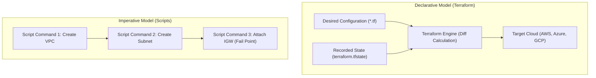

| Dimension | Declarative (Terraform) | Imperative (Bash / AWS CLI / Python) |
| :--- | :--- | :--- |
| **State Tracking** | Native via `terraform.tfstate` | Custom manual database or none |
| **Idempotency** | Guaranteed by reconciliation engine | Requires manual defensive coding |
| **Dependency Graph** | Automatic DAG compilation | Hardcoded sequential ordering |
| **Drift Detection** | Native (`terraform refresh` / `plan`) | Custom audit cron jobs |

### 1.2 Core vs Plugins: The gRPC Provider Architecture
Terraform is architected as an extensible, decoupled binary:
- **Terraform Core**: Written in Go, handles HCL parsing, configuration file merging, state management, and building the execution graph.
- **Terraform Plugins (Providers)**: Separate Go binaries that communicate with Terraform Core over high-performance **RPC/gRPC** sockets using the HashiCorp `go-plugin` system.

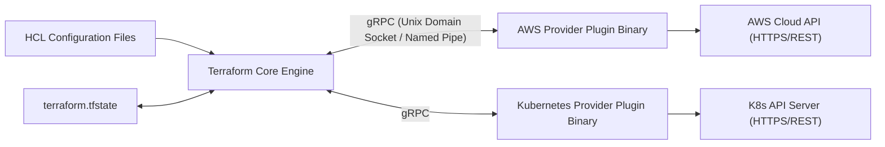

#### Step-by-Step Provider Communication Breakdown
```hcl
terraform {
  required_version = ">= 1.9.0"
  required_providers {
    aws = {
      source  = "hashicorp/aws"
      version = "~> 5.50.0"
    }
  }
}

provider "aws" {
  region = "us-east-1"
  default_tags {
    tags = {
      Environment = "Production"
      ManagedBy   = "Terraform"
    }
  }
}
```

| Line / Block | Syntax Structure | Architectural Purpose |
| :--- | :--- | :--- |
| `terraform { ... }` | Core meta-block | Establishes engine and provider requirements |
| `required_version` | SemVer constraint | Enforces minimum Terraform binary execution version |
| `required_providers` | Provider mapping block | Instructs Core where to fetch plugin binaries from registry |
| `source = "hashicorp/aws"` | Hostname/Namespace/Type | Fully Qualified Provider Name (FQPN) pointing to registry.terraform.io |
| `version = "~> 5.50.0"` | Pessimistic constraint | Allows updates up to < 6.0.0 while locking major release |
| `provider "aws" { ... }` | Provider instantiation | Configures authentication credentials, endpoints, and regions |
| `default_tags { ... }` | Provider default feature | Injects standard enterprise governance tags across all child resources |

### 1.3 Directed Acyclic Graph (DAG) Dependency Engine
Terraform constructs a **Directed Acyclic Graph (DAG)** of all resources declared in your `.tf` files. Nodes represent resources, data sources, and provider instances; edges represent implicit or explicit dependencies.

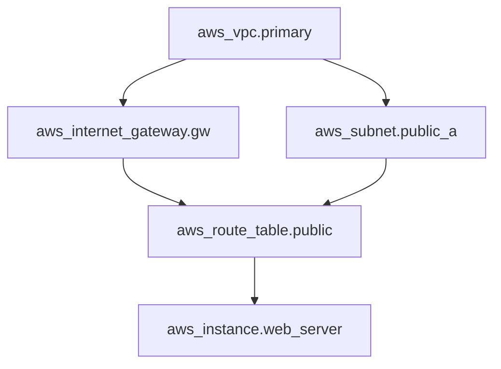

Terraform traverses this graph concurrently:
- Independent nodes are provisioned in parallel (governed by `-parallelism=10` default).
- Dependent nodes wait for parent resolution.
- Cycles (e.g., Node A depends on Node B, which depends on Node A) trigger fatal graph cycle errors.

### 1.4 The Terraform Engine Lifecycle: Init, Plan, Apply, Destroy
Every Terraform workflow progresses through 4 core phases:

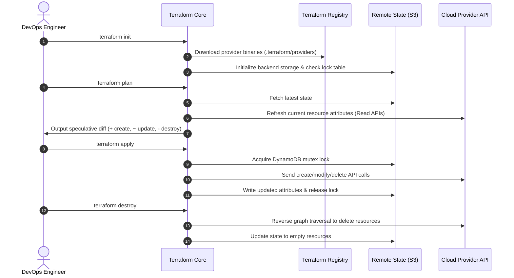

#### Detailed CLI Command Breakdown
```bash
# Initialize working directory, download provider plugins, configure backend
terraform init -upgrade

# Validate HCL syntax and semantic correctness without cloud API calls
terraform validate

# Generate speculative execution plan and persist to disk for immutable execution
terraform plan -out=tfplan.binary -var="environment=production"

# Apply the pre-compiled plan atomically
terraform apply tfplan.binary

# Destroy all managed infrastructure in safe reverse dependency order
terraform destroy -auto-approve
```

| Parameter / Flag | Purpose | Operational Best Practice |
| :--- | :--- | :--- |
| `-upgrade` | Checks registry for newer allowed provider versions | Use during scheduled maintenance sprints |
| `validate` | Validates attribute types and block schemas | Run in pre-commit hooks and CI linters |
| `-out=tfplan.binary` | Locks speculative plan into binary artifact | Mandatory in enterprise CI/CD to prevent drift between plan and apply |
| `-auto-approve` | Skips interactive `yes/no` terminal prompt | Strictly reserved for automated CI/CD worker agents |

---


### 1.5 The Modern IaC Landscape: HashiCorp BSL vs OpenTofu (Linux Foundation)
In August 2023, HashiCorp announced a license shift from open-source Mozilla Public License v2.0 (MPL 2.0) to the Business Source License v1.1 (BSL 1.1). In response, the cloud-native ecosystem formed **OpenTofu**, an open-source, community-governed fork under the Linux Foundation.

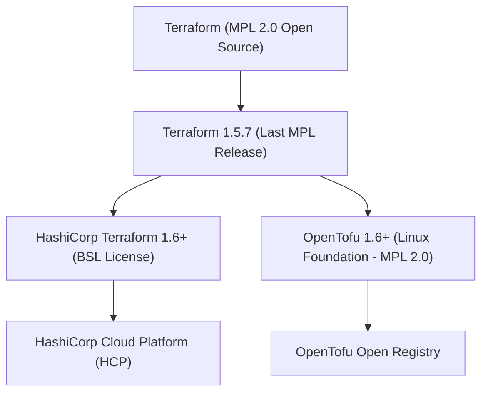

| Feature / Dimension | HashiCorp Terraform | OpenTofu (Linux Foundation) |
| :--- | :--- | :--- |
| **Licensing** | Business Source License (BSL 1.1) | Mozilla Public License (MPL 2.0) |
| **Governance** | HashiCorp / IBM Corporate Steering | Open Governance under Linux Foundation |
| **Registry** | registry.terraform.io | get.opentofu.org (Decentralized fallback) |
| **State Encryption** | HCP Enterprise feature | Native Client-Side State Encryption (`tofu`) |
| **CLI Compatibility** | `terraform <command>` | Drop-in replacement `tofu <command>` |

#### Migrating from Terraform to OpenTofu
```bash
# 1. Install OpenTofu via package manager
# (Linux/macOS)
brew install opentofu

# 2. Verify drop-in CLI compatibility in existing repository
tofu init

# 3. Inspect existing state file without modifying format
tofu plan

# 4. Leverage native client-side state encryption in OpenTofu
# encryption.tofu
tofu apply
```

### 1.6 Terraform Native Testing Framework (`terraform test`)
Introduced in Terraform 1.6, `terraform test` provides native integration and unit testing for modules without requiring external Go or Python test runners.

```hcl
# tests/vpc_validation.tftest.hcl
run "verify_vpc_cidr_and_subnets" {
  command = plan

  variables {
    vpc_cidr            = "10.0.0.0/16"
    public_subnet_cidrs = ["10.0.1.0/24", "10.0.2.0/24"]
  }

  assert {
    condition     = aws_vpc.main.cidr_block == "10.0.0.0/16"
    error_message = "VPC CIDR block does not match the configured variable input."
  }

  assert {
    condition     = length(aws_subnet.public) == 2
    error_message = "Expected exactly 2 public subnets to be provisioned."
  }
}
```

| Test Attribute | Technical Purpose |
| :--- | :--- |
| `run "test_name"` | Defines an isolated test block with execution scope |
| `command = plan` | Specifies speculative test (no real cloud resources provisioned) |
| `command = apply` | Provisions ephemeral sandbox resources, validates assertions, and runs teardown |
| `assert { condition = ... }` | Boolean expression that must evaluate to true for the test step to pass |

## 2. Stage 2: HCL2 Syntax & Metaprogramming Mastery

### 2.1 Variables, Validations, and Sensitive Types
Terraform variable declarations define clear contracts for root and child modules. Modern HCL2 supports complex custom validation blocks and data masking.

```hcl
variable "environment" {
  description = "Target deployment environment"
  type        = string
  default     = "staging"

  validation {
    condition     = contains(["development", "staging", "production"], var.environment)
    error_message = "Allowed values for environment are: development, staging, production."
  }
}

variable "database_password" {
  description = "Master password for primary database cluster"
  type        = string
  sensitive   = true

  validation {
    condition     = length(var.database_password) >= 16
    error_message = "Database password must be at least 16 characters in length."
  }
}
```

| Attribute | Significance |
| :--- | :--- |
| `type` | Enforces static type checking during compilation (`string`, `number`, `bool`, `list`, `map`, `object`) |
| `sensitive = true` | Redacts value from CLI terminal output, plan diffs, and console logs (Note: value remains plaintext in `.tfstate`) |
| `validation { ... }` | Custom expression evaluated during plan time before any cloud calls |
| `error_message` | User-friendly diagnostic message returned if validation expression evaluates to `false` |

### 2.2 Collections, Complex Objects, and Type Constraints
HCL2 permits nested object typing for strict schema enforcement across large engineering teams:

```hcl
variable "cluster_config" {
  description = "Kubernetes node pool configuration schema"
  type = object({
    cluster_name  = string
    node_count    = number
    instance_type = string
    zones         = list(string)
    auto_scaling  = object({
      min_nodes = number
      max_nodes = number
    })
    tags = optional(map(string), {})
  })
}
```

### 2.3 Expressions: Splats, For Loops, Dynamic Blocks, and Coalesce
Modern HCL2 offers functional metaprogramming expressions:

#### 1. Splat Expressions `[*]` and For Loops
```hcl
# Input list of objects
variable "users" {
  type = list(object({
    username = string
    role     = string
    active   = bool
  }))
}

# For loop filtering active admins
locals {
  admin_usernames = [
    for u in var.users : u.username if u.role == "admin" && u.active
  ]

  # Map transformation
  user_role_map = {
    for u in var.users : u.username => u.role
  }
}

# Splat extraction of all subnet IDs
output "subnet_ids" {
  value = aws_subnet.public[*].id
}
```

#### 2. Dynamic Blocks for Nested Resource Configurations
Dynamic blocks generate repeated nested blocks programmatically without duplicating HCL code:

```hcl
variable "ingress_rules" {
  type = list(object({
    port        = number
    description = string
    protocol    = string
    cidr_blocks = list(string)
  }))
  default = [
    { port = 80,  description = "HTTP Ingress",  protocol = "tcp", cidr_blocks = ["0.0.0.0/0"] },
    { port = 443, description = "HTTPS Ingress", protocol = "tcp", cidr_blocks = ["0.0.0.0/0"] }
  ]
}

resource "aws_security_group" "web" {
  name        = "production-web-sg"
  description = "Security group for web tier"
  vpc_id      = aws_vpc.main.id

  dynamic "ingress" {
    for_each = var.ingress_rules
    content {
      description = ingress.value.description
      from_port   = ingress.value.port
      to_port     = ingress.value.port
      protocol    = ingress.value.protocol
      cidr_blocks = ingress.value.cidr_blocks
    }
  }

  egress {
    from_port   = 0
    to_port     = 0
    protocol    = "-1"
    cidr_blocks = ["0.0.0.0/0"]
  }
}
```

| Element | Mechanics |
| :--- | :--- |
| `dynamic "ingress"` | Declares that nested `ingress` blocks will be generated dynamically |
| `for_each` | Iterates over the collection provided in `var.ingress_rules` |
| `content { ... }` | Body of the generated nested block |
| `ingress.value` | Iterator referencing the current item in the iteration |

### 2.4 Built-in Functions: Collection, Cryptographic, String, and Encoding
HCL2 provides pure, side-effect-free built-in functions:

```hcl
locals {
  raw_subnets = [["10.0.1.0/24", "10.0.2.0/24"], ["10.0.3.0/24"]]
  
  # Flatten nested lists
  flat_subnets = flatten(local.raw_subnets)

  # Merge multiple maps
  combined_tags = merge(
    { Owner = "DevOps" },
    { Project = "Nebula" },
    var.extra_tags
  )

  # Safely parse JSON or handle failure with can()
  raw_config = "{\"version\": 2}"
  parsed_version = can(jsondecode(local.raw_config)) ? jsondecode(local.raw_config).version : 1

  # Compute cryptographic SHA256 hash of Lambda archive
  code_hash = filesha256("${path.module}/dist/app.zip")
}
```

---

## 3. Stage 3: State Mechanics, Locking, and Drift Remediation

### 3.1 State File Anatomy and Resource Mapping
Terraform's state file (`terraform.tfstate`) is an internal JSON document mapping real-world cloud resources to declared HCL blocks.

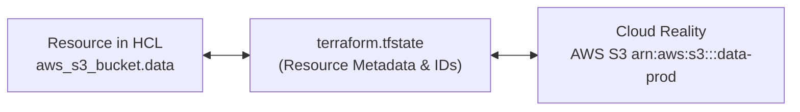

Key attributes tracked in `terraform.tfstate`:
- `serial`: Incrementing integer tracking schema updates.
- `lineage`: Unique UUID identifying the state file life cycle.
- `resources`: Array of objects detailing provider, type, instances, attributes, and dependencies.

### 3.2 Remote Backend Locking with AWS S3 and DynamoDB
In multi-engineer enterprise environments, storing state locally leads to catastrophic race conditions. A distributed backend with S3 and DynamoDB ensures state persistence, encryption, versioning, and exclusive mutex locking.

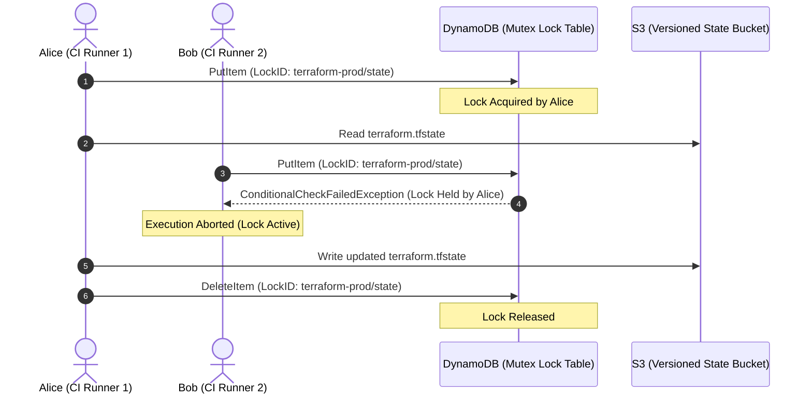

#### Production Backend Configuration
```hcl
terraform {
  backend "s3" {
    bucket         = "acme-corp-terraform-state-prod"
    key            = "infrastructure/vpc/terraform.tfstate"
    region         = "us-east-1"
    encrypt        = true
    dynamodb_table = "acme-corp-terraform-locks"
  }
}
```

| Parameter | Operational Best Practice |
| :--- | :--- |
| `bucket` | Must have S3 Object Versioning enabled and public access blocked |
| `key` | Unique hierarchical path separating micro-stacks |
| `encrypt = true` | Enforces AWS server-side encryption (AES-256 or KMS) at rest |
| `dynamodb_table` | DynamoDB table with Primary Key named `LockID` (String) |

### 3.3 State Operations: Migration, Inspection, Removal, and Renaming
Manipulating state via CLI is an essential skill when refactoring without destroying production resources:

```bash
# List all resources tracked in active state
terraform state list

# Show detailed attributes of a single tracked resource
terraform state show aws_instance.web_server

# Rename a resource address without recreating the real cloud resource
terraform state mv aws_instance.old_name aws_instance.new_name

# Move resource into a child module
terraform state mv aws_security_group.web module.network.aws_security_group.web

# Remove resource from state tracking without deleting cloud resource
terraform state rm aws_s3_bucket.legacy_logs
```

### 3.4 Modern Import Blocks (Terraform 1.5+) vs Legacy CLI Import
Historically, importing existing infrastructure required running `terraform import <address> <id>` followed by manually writing the matching HCL block. Terraform 1.5+ introduced declarative `import` blocks with automated code generation.

```hcl
# Declarative import block
import {
  to = aws_security_group.database
  id = "sg-0123456789abcdef0"
}

# Auto-generate HCL code during plan
# terraform plan -generate-config-out=generated_sg.tf
```

| Step | Action | Command / Code |
| :--- | :--- | :--- |
| 1 | Declare import target | `import { to = aws_vpc.main; id = "vpc-0a1b2c3d" }` |
| 2 | Speculative Generation | `terraform plan -generate-config-out=generated_vpc.tf` |
| 3 | Review Generated Code | Inspect `generated_vpc.tf` for formatting and variables |
| 4 | Atomic Apply | `terraform apply` to register resource into state cleanly |

---

## 4. Stage 4: Modular Architecture & Production Reusability

### 4.1 Enterprise Module Decomposition Principles
Modules encapsulate infrastructure patterns into reusable components. A well-designed module follows the Unix philosophy: do one thing and do it well.

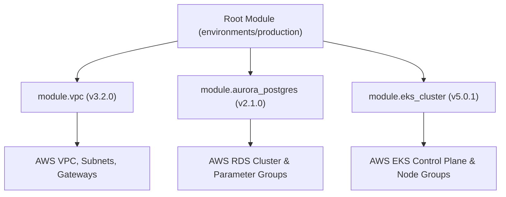

#### Golden Rules for Modular Design:
1. **Never hardcode provider blocks inside reusable child modules**: The root module must provide and configure providers.
2. **Never hardcode backend blocks inside child modules**: Backends belong strictly in root orchestrators.
3. **Always output the core IDs and ARNs**: Enable downstream composition.

### 4.2 Module Contracts: Inputs, Outputs, and Semantic Versioning
Standard module directory structure:
```text
modules/aws-vpc/
├── README.md           # Documentation generated via terraform-docs
├── main.tf             # Core resource declarations
├── variables.tf        # Input variable definitions with types & descriptions
├── outputs.tf          # Output values with clear descriptions
├── versions.tf         # Provider and Terraform version constraints
└── tests/              # Native Terraform test files (run via terraform test)
```

#### Module Output Example (`outputs.tf`)
```hcl
output "vpc_id" {
  description = "The ID of the provisioned VPC"
  value       = aws_vpc.this.id
}

output "private_subnet_ids" {
  description = "List of IDs of private subnets"
  value       = aws_subnet.private[*].id
}

output "database_subnet_group_name" {
  description = "Name of database subnet group for RDS integration"
  value       = aws_db_subnet_group.this.name
}
```

### 4.3 Terragrunt and DRY Configuration Patterns
As enterprise infrastructure scales across dozens of accounts and environments, vanilla Terraform can lead to repetitive backend and provider declarations. **Terragrunt** acts as a thin wrapper that keeps HCL DRY (Don't Repeat Yourself).

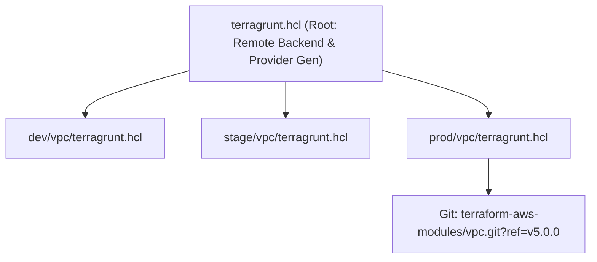

#### Root `terragrunt.hcl`
```hcl
remote_state {
  backend = "s3"
  generate = {
    path      = "backend.tf"
    if_exists = "overwrite_terragrunt"
  }
  config = {
    bucket         = "acme-terragrunt-state-${get_aws_account_id()}"
    key            = "${path_relative_to_include()}/terraform.tfstate"
    region         = "us-east-1"
    encrypt        = true
    dynamodb_table = "acme-terragrunt-locks"
  }
}
```

### 4.4 Local and Remote Module Registry Distribution
Modules can be sourced from various repositories:

```hcl
# Sourcing from local directory
module "networking" {
  source = "../../modules/networking"
}

# Sourcing from Terraform Public Registry with SemVer pin
module "security_group" {
  source  = "terraform-aws-modules/security-group/aws"
  version = "~> 5.1.0"
}

# Sourcing from Private Git Repository over SSH with Git Tag pin
module "billing_engine" {
  source = "git::git@github.com:acme-corp/infra-modules.git//payment-pipeline?ref=v2.4.1"
}
```

---

## 5. Stage 5: Multi-Environment Orchestration & Workspaces

### 5.1 CLI Workspaces vs Directory-Isolated Stacks
There are two primary paradigms for managing multiple environments (Dev, Stage, Prod):

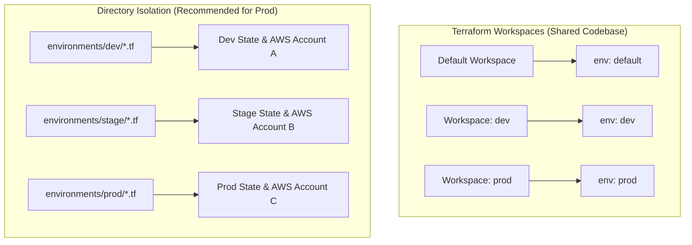

| Dimension | CLI Workspaces (`terraform workspace`) | Directory-Isolated Stacks |
| :--- | :--- | :--- |
| **State Storage** | Single bucket under `env:/<workspace_name>/` | Completely separate S3 buckets & DynamoDB tables |
| **Blast Radius** | High (Code changes affect all workspaces) | Low (Each environment config is independently versioned) |
| **Access Control** | Hard to enforce per-environment IAM | Native AWS IAM per bucket/directory |
| **Best Use Case** | Ephemeral feature branches / testing | Long-lived environments (Dev, QA, Staging, Prod) |

### 5.2 Multi-Account and Multi-Region Architectures
Production cloud systems distribute workloads across isolated AWS accounts (e.g., Security, Shared Services, Dev, Prod) and multiple geographic regions.

```hcl
# Default provider for Primary Region (US East)
provider "aws" {
  alias  = "us_east_1"
  region = "us-east-1"
}

# Aliased provider for Disaster Recovery Region (US West)
provider "aws" {
  alias  = "us_west_2"
  region = "us-west-2"
}

# Resource in primary region
resource "aws_s3_bucket" "primary" {
  provider = aws.us_east_1
  bucket   = "acme-corp-media-primary"
}

# Replica in secondary region
resource "aws_s3_bucket" "replica" {
  provider = aws.us_west_2
  bucket   = "acme-corp-media-replica"
}
```

### 5.3 Cross-Stack Data Sharing via `terraform_remote_state` and SSM
To prevent monolithic blast radiuses, infrastructure should be decoupled into smaller stacks:
1. Base Network Stack (VPC, Subnets, NAT Gateways)
2. Data Stack (RDS, Redis, DynamoDB)
3. Compute Stack (EKS, ECS, Lambda)

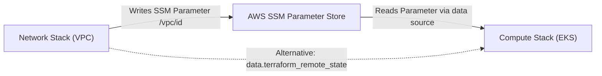

```hcl
# Read remote state from networking stack
data "terraform_remote_state" "network" {
  backend = "s3"
  config = {
    bucket = "acme-corp-terraform-state-prod"
    key    = "infrastructure/vpc/terraform.tfstate"
    region = "us-east-1"
  }
}

resource "aws_security_group" "app" {
  name   = "app-server-sg"
  vpc_id = data.terraform_remote_state.network.outputs.vpc_id
}
```

---

## 6. Stage 6: Enterprise Security, Governance & Automated CI/CD

### 6.1 Policy as Code: Open Policy Agent (OPA/Rego) & Sentinel
Policy as Code enforces security guardrails before any cloud resource is modified or provisioned.

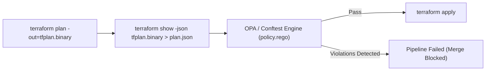

#### Example Open Policy Agent (OPA) Rule in Rego:
```rego
package terraform.security

default allow = false

# Deny any unencrypted S3 bucket creation
deny[msg] {
    resource := input.resource_changes[_]
    resource.type == "aws_s3_bucket"
    not resource.change.after.server_side_encryption_configuration
    msg := sprintf("Security Violation: S3 bucket '%v' must have server-side encryption enabled.", [resource.address])
}

allow {
    count(deny) == 0
}
```

### 6.2 Static Security Scanning: Checkov, tfsec, and Trivy
Pre-commit and CI scans detect misconfigurations early in the development cycle:

```bash
# Scan repository using Checkov for compliance violations (CIS, HIPAA, PCI-DSS)
checkov -d . --framework terraform

# Fast, lightweight static security analysis with Trivy
trivy config ./infrastructure

# Lint HCL syntax, deprecated features, and unused variables with TFLint
tflint --init && tflint
```

| Security Linter | Specialization | Integration Point |
| :--- | :--- | :--- |
| **Checkov** | Deep policy inspection across AWS/GCP/Azure compliance frameworks | CI pull request gating |
| **TFLint** | Catches cloud provider-specific errors (invalid instance types) | Pre-commit hook & local IDE |
| **Trivy** | Unified scanner for IaC, Docker images, and SBOM licenses | Containerized CI pipeline runner |

### 6.3 Secure Secret Injection: HashiCorp Vault & AWS KMS
Never store secrets, database passwords, or private API keys directly in `.tf` code or variable files.

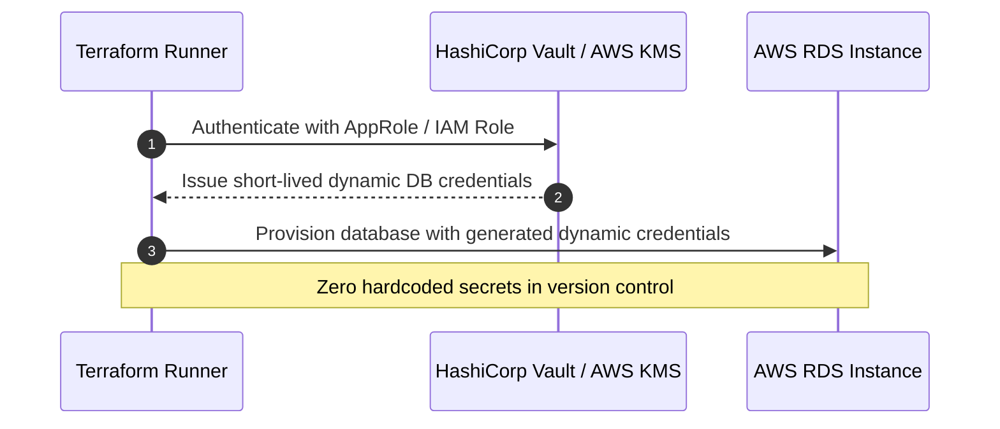

```hcl
# Fetch dynamic database password from HashiCorp Vault
data "vault_generic_secret" "db_creds" {
  path = "secret/data/production/database"
}

resource "aws_db_instance" "prod" {
  identifier          = "production-postgres"
  engine              = "postgres"
  instance_class      = "db.r6g.xlarge"
  username            = "dbadmin"
  password            = data.vault_generic_secret.db_creds.data["password"]
  skip_final_snapshot = false
}
```

### 6.4 GitOps Pipeline Automation with Atlantis and GitHub Actions
Enterprise Terraform requires automated pull-request execution with full auditability.

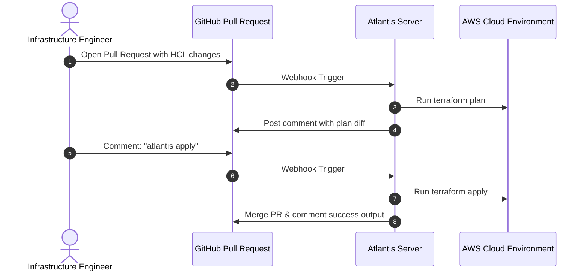

---

## 7. Stage 7: Staff SRE & Cloud Architect Interview Handbook

### 7.1 Real-World High-Stakes Production Scenarios

#### Scenario A: The Accidental Monolithic Blast Radius
- **Incident**: An engineer changes an internal ingress security group rule. Because the VPC, subnets, database, and Kubernetes clusters are in one monolithic root `.tf` state, the plan detects an inadvertent parameter group change, attempting to recreate the production Aurora cluster.
- **Root Cause**: Monolithic state coupling.
- **Mitigation & Resolution**: Immediately cancel apply. Decouple the monolith using `terraform state mv` to separate network, data, and compute into distinct remote state keys.

#### Scenario B: Corrupted Remote State During Split-Brain Apply
- **Incident**: S3 versioned state becomes corrupted due to a partial network disconnect while releasing a DynamoDB lock.
- **Remediation**:
  1. Inspect DynamoDB locks: `aws dynamodb scan --table-name acme-corp-terraform-locks`.
  2. If locked by dead runner, release safely: `terraform force-unlock <LOCK_ID>`.
  3. Revert state to previous clean S3 object version: `aws s3api copy-object --copy-source bucket/state?versionId=<CLEAN_VER> --bucket bucket --key state`.
  4. Run `terraform refresh` to reconcile real cloud resource attributes without executing changes.

---

### 7.2 25 Exhaustive Technical Interview Questions & Answers

#### Q1: What is the core difference between `terraform plan` and `terraform apply -refresh-only`?
> **Answer**:
> - `terraform plan`: Generates a speculative execution plan. It refreshes state against real cloud infrastructure, evaluates HCL configuration changes, and computes the delta needed to bring reality in line with configuration.
> - `terraform apply -refresh-only`: Only inspects the real-world infrastructure and updates the state file to reflect external changes (drift) without proposing or applying any modifications to actual cloud resources.

#### Q2: How does Terraform construct its Directed Acyclic Graph (DAG) and resolve execution order?
> **Answer**:
> During graph compilation, Terraform parses all resource blocks and inspects references. When Resource B accesses an exported attribute of Resource A (e.g., `vpc_id = aws_vpc.primary.id`), an implicit dependency edge is created ($A 	o B$). Terraform uses topological sorting (Kahn's algorithm or DFS) to determine node execution order. Nodes without incoming edges are scheduled concurrently up to the `-parallelism` limit. Explicit dependencies can be enforced using `depends_on = [aws_vpc.primary]`.

#### Q3: Why does `count` cause unexpected destructions when removing an item from the middle of a list, and how does `for_each` solve this?
> **Answer**:
> `count` keys resources by an array integer index (`aws_subnet.public[0]`, `aws_subnet.public[1]`, `aws_subnet.public[2]`). If `subnets[1]` is removed from the input list, the item previously at index 2 shifts to index 1. Terraform detects that `subnets[1]` changed its CIDR block and `subnets[2]` no longer exists, causing it to destroy and recreate resources.
> In contrast, `for_each` keys resources by a stable unique map string key or set value (`aws_subnet.public["us-east-1a"]`). Removing an item only deletes that specific keyed resource, leaving all other instances untouched.

#### Q4: How do you handle circular dependencies in Terraform?
> **Answer**:
> Circular dependencies occur when Resource A requires an attribute from Resource B, which simultaneously requires an attribute from Resource A. Examples include Security Group A allowing ingress from Security Group B and vice-versa.
> To resolve this, decompose the mutual dependency into an independent standalone resource. Instead of defining inline `ingress` blocks inside `aws_security_group`, declare separate `aws_security_group_rule` resources, breaking the dependency cycle in the DAG.

#### Q5: What happens under the hood during `terraform init`?
> **Answer**:
> 1. Reads the backend block and configures state storage (validating S3 bucket access, DynamoDB lock table existence).
> 2. Inspects `required_providers` blocks and searches the local cache directory (`.terraform/providers`).
> 3. Queries the Terraform Registry API to resolve SemVer constraints, downloads provider plugin binaries, verifies their SHA-256 cryptographic signatures against the `.terraform.lock.hcl` dependency lock file, and places the binaries in the working directory.
> 4. Downloads referenced child modules (local, Git, or Registry) into `.terraform/modules`.

#### Q6: Explain the role and security implications of the `.terraform.lock.hcl` file.
> **Answer**:
> Introduced in Terraform 0.14, the dependency lock file pins the exact provider versions and cryptographic checksums (hashes) for all providers used in the configuration. It guarantees deterministic builds across different developer laptops and CI/CD agents, preventing supply chain attacks or accidental breaking changes caused by unpinned upstream provider releases. It must always be committed to version control.

#### Q7: How does Terraform handle sensitive values, and what is its biggest limitation?
> **Answer**:
> Setting `sensitive = true` prevents Terraform from displaying the value in CLI stdout, plan outputs, and logs. However, **the sensitive value is still stored in plaintext in the `terraform.tfstate` file**. Therefore, protecting state storage (via S3 SSE-KMS encryption, strict IAM bucket policies, and access auditing) is mandatory.

#### Q8: What is State Drift, and what are the three primary strategies to remediate it?
> **Answer**:
> State drift occurs when real cloud resources are modified outside of Terraform (via the Cloud Console, direct API calls, or emergency hotfixes).
> Strategies:
> 1. **Overwrite Drift**: Run `terraform apply` to overwrite external changes and force cloud reality back to the declared HCL configuration.
> 2. **Adopt Drift**: Update the `.tf` configuration files to match the new out-of-band attributes, then run `terraform apply` (which results in a 0-change plan).
> 3. **Refresh Only**: Run `terraform apply -refresh-only` to update the state file to match reality without changing configuration or infrastructure.

#### Q9: What is the difference between `terraform taint` and `terraform apply -replace`?
> **Answer**:
> `terraform taint` was the legacy command that marked a resource in the state file as degraded, forcing its destruction and recreation on the next apply. Since Terraform 0.15.2, `terraform taint` is deprecated in favor of the non-mutating CLI option `terraform apply -replace="aws_instance.web"`, which marks the resource for replacement during the speculative plan phase without directly altering the state file beforehand.

#### Q10: How do you safely import thousands of legacy pre-existing cloud resources into Terraform?
> **Answer**:
> 1. Use automated discovery tools (e.g., `terraformer` or `former2`) to inspect cloud resources and generate HCL declarations and state mappings.
> 2. Use Terraform 1.5+ declarative `import` blocks:
>    ```hcl
>    import {
>      to = aws_s3_bucket.legacy[each.key]
>      for_each = toset(["bucket-a", "bucket-b"])
>      id = each.key
>    }
>    ```
> 3. Execute `terraform plan -generate-config-out=generated.tf` to let Terraform construct the matching resource configurations.
> 4. Validate and sanitize generated code, then run `terraform apply`.

#### Q11: Explain the purpose and operation of `prevent_destroy` within the `lifecycle` meta-block.
> **Answer**:
> `lifecycle { prevent_destroy = true }` is a safety mechanism enforced by Terraform Core during plan time. If an execution plan would result in the destruction of that resource (either via explicit deletion, or recreation caused by changing an immutable attribute), Terraform rejects the plan with an immediate error. Note: it does not prevent destruction if `terraform destroy` is explicitly run on the entire stack.

#### Q12: How does `create_before_destroy` work, and what pitfalls can it introduce?
> **Answer**:
> By default, when a resource requires replacement, Terraform destroys the old resource first and then creates the replacement. With `lifecycle { create_before_destroy = true }`, Terraform reverses this order: it provisions the new resource, switches dependencies over, and then tears down the old resource, achieving zero-downtime updates.
> **Pitfall**: Resources with unique naming constraints (e.g., an S3 bucket or IAM role with a hardcoded static name) will fail because the new resource cannot be created while the old resource still holds that unique name.

#### Q13: How do you manage zero-downtime database migrations with Terraform?
> **Answer**:
> Direct database schema migrations should never be managed via Terraform (use specialized tools like Flyway, Liquibase, or Prisma). For infrastructure-level database updates (e.g., upgrading RDS instance classes or engine versions):
> 1. Use Multi-AZ deployments so AWS applies upgrades to the standby replica first, triggers a graceful failover (<60s), and then upgrades the former primary.
> 2. Set `apply_immediately = false` so updates occur during scheduled maintenance windows, preventing unexpected mid-day downtime.

#### Q14: What is the difference between an input variable default, an environment variable `TF_VAR_name`, and a `.tfvars` file?
> **Answer**:
> Terraform resolves variable values using a strict order of precedence (highest to lowest):
> 1. CLI flags: `-var` or `-var-file`
> 2. `*.auto.tfvars` or `*.auto.tfvars.json` (alphabetical order)
> 3. `terraform.tfvars.json`
> 4. `terraform.tfvars`
> 5. Environment variables: `TF_VAR_<variable_name>`
> 6. Default value defined inside the `variable` declaration block.

#### Q15: When should you use `terraform_remote_state` versus AWS Systems Manager (SSM) Parameter Store for cross-stack references?
> **Answer**:
> - `terraform_remote_state`: Tight coupling. Requires read access to the upstream stack's state file. Exposes all outputs and potentially exposes sensitive state metadata.
> - **SSM Parameter Store / AWS Secrets Manager (Recommended)**: Loose coupling. The upstream stack publishes output values as standard SSM parameters (`/network/vpc_id`). Downstream stacks read these via `data "aws_ssm_parameter"` data sources. This enforces least-privilege IAM separation and decouples team deployment lifecycles.

#### Q16: How do you debug provider crashes or internal Terraform Core panics?
> **Answer**:
> Enable verbose debugging logs by setting environment variables:
> - `TF_LOG=DEBUG` (or `TRACE`, `INFO`, `WARN`, `ERROR`)
> - `TF_LOG_PATH=/path/to/terraform.log`
> `TRACE` outputs the exact JSON-RPC / gRPC payloads sent between Terraform Core and the provider binary, HTTP requests/responses to cloud endpoints, and detailed graph resolution decisions.

#### Q17: What are the security risks of storing `terraform.tfstate` in an unencrypted S3 bucket?
> **Answer**:
> The state file contains a complete architectural map of your cloud estate, including resource IDs, network topologies, IAM role definitions, and any variables or attributes passed to resources—even those marked `sensitive = true`. If unencrypted, compromised read access allows an attacker to discover database endpoints, VPC CIDRs, and secret API keys in plaintext.

#### Q18: How do you implement automated testing in Terraform?
> **Answer**:
> 1. **Unit / Syntax Testing**: `terraform validate` and `tflint`.
> 2. **Static Security Testing**: `checkov` and `trivy`.
> 3. **Native Integration Testing (Terraform 1.6+)**: The `terraform test` command runs `.tftest.hcl` files, executing synthetic plans and applies against sandboxed environments with custom assertion blocks (`assert { condition = ... }`).
> 4. **End-to-End Infrastructure Testing**: **Terratest** (Go framework) provisions real cloud infrastructure, sends HTTP/SSH requests to verify functionality, and executes `t.Cleanup(terraform.Destroy)`.

#### Q19: Explain the difference between `merge()` and `coalesce()` in HCL2.
> **Answer**:
> - `merge(map1, map2, ...)`: Combines multiple maps into a single map. If keys overlap, values from the rightmost map overwrite earlier ones.
> - `coalesce(val1, val2, ...)`: Takes any number of arguments and returns the first value that is not null and not an empty string `""`.

#### Q20: What is the Provider Protocol, and what changed between Protocol Version 5 and Version 6?
> **Answer**:
> The Provider Protocol defines the gRPC interface between Terraform Core and provider plugins. Version 5 was based on the legacy SDKv2. Version 6 powers the modern **Terraform Plugin Framework**, supporting structured type systems, dynamic object attributes, nested attributes with nullability, and significantly faster serialization speeds.

#### Q21: How do you enforce cost control and budgeting in Terraform before deploying?
> **Answer**:
> Integrate **Infracost** into the CI/CD pipeline. Infracost parses the speculative `terraform plan` JSON output, queries cloud pricing APIs, and posts a comment on the GitHub pull request showing the exact monthly delta cost (e.g., `+$142.50/mo`) before merging.

#### Q22: What is the difference between `terraform state rm` and destroying a resource?
> **Answer**:
> - `terraform state rm`: Deletes the resource tracking entry from `terraform.tfstate`. The real cloud resource remains alive and untouched in AWS/GCP, but Terraform ceases to manage it.
> - `terraform destroy` (or deleting the block and running `apply`): Sends a delete API call to the cloud provider, permanently terminating the real-world infrastructure.

#### Q23: How do you prevent race conditions when multiple CI/CD runners trigger on simultaneous Git pushes?
> **Answer**:
> Enable distributed state locking (e.g., DynamoDB table for S3 backend, or native Consul locking). When Runner A initiates a plan/apply, it writes an exclusive lock record containing its execution ID. When Runner B attempts execution, it fails to acquire the lock and halts immediately with exit code 1. Additionally, set GitHub Actions `concurrency` groups to cancel in-flight pipelines when new commits are pushed.

#### Q24: What is the purpose of `moved` blocks in Terraform 1.1+?
> **Answer**:
> `moved` blocks allow module authors to refactor resource addresses without requiring end users to manually run CLI commands like `terraform state mv`:
> ```hcl
> moved {
>   from = aws_instance.web
>   to   = aws_instance.frontend_server
> }
> ```
> During `terraform plan`, Terraform recognizes the declaration rename and migrates the state mapping internally without proposing destruction and recreation.

#### Q25: How do you design a zero-trust multi-cloud infrastructure pipeline?
> **Answer**:
> 1. Authenticate CI/CD agents using **OIDC (OpenID Connect)** federated identity with AWS/GCP/Azure instead of long-lived static API credentials.
> 2. Enforce immutable GitOps approvals via Atlantis or GitHub Actions environments.
> 3. Gate deployments using Policy as Code (OPA/Rego) to enforce encryption, private networking, and tagging.
> 4. Keep state files strictly encrypted with customer-managed KMS keys and audited via CloudTrail.
> 5. Continuously audit configuration drift with scheduled read-only cron pipelines.

---

## 8. Community, Contributing & Support

We welcome contributions from cloud engineers worldwide! Please review our contribution guidelines before submitting pull requests.

### Development Workflow
```bash
# 1. Clone your fork
git clone https://github.com/manthanank/learn-terraform.git

# 2. Run automated validation and test suite
node --test tests/terraform.test.mjs

# 3. Format HCL code
terraform fmt -recursive
```

- **Contributing Guidelines**: [CONTRIBUTING.md](CONTRIBUTING.md)
- **Code of Conduct**: [CODE_OF_CONDUCT.md](CODE_OF_CONDUCT.md)
- **License**: [MIT License](LICENSE)

---

<div align="center">
  <p>Maintained with precision by <b>Manthan Ank</b>.</p>
  <a href="https://www.buymeacoffee.com/manthanank">
    
  </a>
</div>
