# Learn Terraform 🧱

<div align="center">

[](https://opensource.org/licenses/MIT)
[](https://developer.hashicorp.com/terraform)
[](https://github.com/TheLearningHubOrg/learn-terraform/actions/workflows/ci.yml)
[](https://github.com/TheLearningHubOrg/learn-terraform/releases)
[](https://opentofu.org/docs/)
[](https://developer.hashicorp.com/terraform/language)

**From your first `terraform init` to staff-level platform engineering with Terraform and OpenTofu.**  
HCL, providers, the dependency graph, state and backends, import and refactoring, modules, environments, native testing, CI/CD, policy as code and secrets.

[Getting Started](#1-stage-1-iac-foundations-cli--the-core-workflow) • [HCL Language](#2-stage-2-hcl-language-variables-expressions--meta-arguments) • [State](#3-stage-3-state-backends-import--drift) • [Modules](#4-stage-4-modules--reusable-architecture) • [Environments & CI/CD](#5-stage-5-environments-testing--cicd) • [Security](#6-stage-6-security-governance--policy-as-code) • [Interview Prep](#7-stage-7-staff-terraform-platform-engineer-interview-handbook--cheatsheet)

<br/>

<a href="https://www.buymeacoffee.com/manthanank">
  
</a>

</div>

---

## 🗺️ 7-Stage Pedagogical Roadmap

Every code example in this guide is HCL (Terraform's own configuration language), with shell commands for the CLI. HCL is the language Terraform reads, so it is the only language you need to learn the tool. The starter project in this repo is a Terraform configuration with native `terraform test` suites, not a wrapper written in another language. Where a later stage covers a tool with its own language (Rego for Open Policy Agent, YAML for GitHub Actions), the example uses that tool's language.

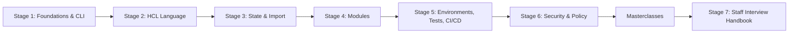

| Stage | Focus Domain | Core Concepts & Engineering Outcomes |
| :--- | :--- | :--- |
| **Stage 1** | **IaC Foundations, CLI & the Core Workflow** | Declarative vs imperative IaC, installing Terraform and OpenTofu, `required_providers` and version constraints, `.terraform.lock.hcl`, the provider plugin protocol, the dependency graph, `init` / `plan` / `apply` / `destroy`, saved plans and `-detailed-exitcode`. You can run, read and explain the starter project. |
| **Stage 2** | **HCL Language, Variables, Expressions & Meta-Arguments** | Types and `optional()`, variable precedence, `validation` (including cross-variable rules), `sensitive` and `ephemeral`, locals and outputs, `for` expressions, splats, `dynamic` blocks, `cidrsubnet()` and other built-ins, `count` vs `for_each`, `lifecycle`, preconditions, postconditions and `check` blocks, data sources. |
| **Stage 3** | **State, Backends, Import & Drift** | State file anatomy (`serial`, `lineage`), the S3 backend with `use_lockfile`, partial backend configuration, `force-unlock`, `state list/show/mv/rm/pull`, `moved` and `removed` blocks, `import` blocks with `-generate-config-out`, `plan -refresh-only`, drift detection in CI, secrets in state and write-only attributes. |
| **Stage 4** | **Modules & Reusable Architecture** | Root vs child modules, module contracts, versioned sources (registry, Git tags), composition over inheritance, Terragrunt for DRY backends. |
| **Stage 5** | **Environments, Testing & CI/CD** | Workspaces vs directory isolation, multi-account and multi-region providers, cross-stack data via `terraform_remote_state` or SSM, `terraform test`, Atlantis and GitHub Actions pipelines. |
| **Stage 6** | **Security, Governance & Policy as Code** | OPA/Rego and Sentinel against plan JSON, Checkov, Trivy and TFLint, Vault and KMS secret injection. |
| **Masterclasses** | **Deep dives** | Advanced internals and an end-to-end platform blueprint (added in the next revision of this guide). |
| **Stage 7** | **Staff Interview Handbook** | Interview Q&As grouped by concepts, internals, architecture and production scenarios, plus a one-page cheatsheet. |

---

## 🆕 Terraform Versions, What's New & Migration

Terraform 1.x keeps a compatibility promise for the language and the state format inside the 1.x line: configuration written for 1.0 still runs on the current stable release. What changes between minor versions is mostly additive (new blocks, new functions, new CLI flags) plus a short list of deprecations. Providers version independently and break more often than Terraform itself, which is why the lock file matters (see [1.5](#15-terraform-init-and-the-dependency-lock-file)).

### V.1 Release Timeline

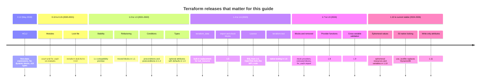

### V.2 Compatibility Matrix

| Terraform | Released | Headline features | Needed for in this guide | OpenTofu equivalent |
| --- | --- | --- | --- | --- |
| 1.5 | June 2023 | `import` blocks, `check` blocks, `-generate-config-out` | [3.7 Import](#37-importing-existing-infrastructure) | 1.6 (forked with these features) |
| 1.6 | October 2023 | `terraform test`, S3 backend `assume_role` block | [Stage 5 testing](#54-native-testing-with-terraform-test) | 1.6 |
| 1.7 | January 2024 | Mock providers, `removed` block, `for_each` in `import` | [3.6 removed](#36-refactoring-without-downtime-moved-and-removed-blocks), starter `tests/mocked_apply.tftest.hcl` | current stable (OpenTofu 1.7 added client-side state encryption) |
| 1.8 | April 2024 | Provider-defined functions (`provider::aws::arn_parse`) | [2.6 Functions](#26-built-in-functions-and-terraform-console) | 1.7 |
| 1.9 | June 2024 | Variable validation may reference other variables; `moved` from `null_resource` to `terraform_data` | Starter `variables.tf` (`owner`, `subnet_newbits`) | current stable |
| 1.10 | November 2024 | Ephemeral resources and variables, S3 native lock file | [3.3 S3 backend](#33-remote-state-on-s3-with-native-locking), [3.9 Secrets](#39-protecting-state-encryption-access-and-secrets) | current stable |
| 1.11 | February 2025 | Write-only managed resource attributes (`*_wo`) | [3.9 Secrets](#39-protecting-state-encryption-access-and-secrets) | current stable |
| 1.12 (CI pin) | 2025 | Import by resource identity, test framework fixes | Starter project and CI are pinned to 1.12.2 | current stable |
| current stable | 2026 | Every example in this guide runs on it | All stages | current stable |

The starter's `required_version = ">= 1.9.0"` is the true floor for its code. CI and the Dockerfile pin 1.12.2 so the build is reproducible; raise `TERRAFORM_VERSION` in both places to move forward.

### V.3 What's New in Recent Releases (1.10 to current stable)

#### Native S3 state locking

The S3 backend can lock with a `.tflock` object written next to the state using S3 conditional writes. The DynamoDB table that every AWS team used to create by hand is no longer needed.

Before:

```hcl
terraform {
  backend "s3" {
    bucket         = "acme-tfstate"
    key            = "network/terraform.tfstate"
    region         = "eu-west-1"
    dynamodb_table = "acme-tf-locks" # extra table, extra IAM, extra cost
  }
}
```

After:

```hcl
terraform {
  backend "s3" {
    bucket       = "acme-tfstate"
    key          = "network/terraform.tfstate"
    region       = "eu-west-1"
    use_lockfile = true # lock object: network/terraform.tfstate.tflock
  }
}
```

#### Ephemeral resources and write-only attributes

Until 1.10 every value a resource or data source read ended up in the state file, including generated passwords. Ephemeral resources produce values that exist only during one run, and write-only attributes (1.11) let a provider accept a value without ever storing it.

Before (password lives in state twice: in `random_password` and in `aws_db_instance`):

```hcl
resource "random_password" "db" {
  length  = 24
  special = false
}

resource "aws_db_instance" "main" {
  identifier        = "orders"
  engine            = "postgres"
  instance_class    = "db.t4g.micro"
  allocated_storage = 20
  username          = "orders_admin"
  password          = random_password.db.result
}
```

After (nothing secret is persisted; bump the version to rotate):

```hcl
ephemeral "random_password" "db" {
  length  = 24
  special = false
}

resource "aws_db_instance" "main" {
  identifier          = "orders"
  engine              = "postgres"
  instance_class      = "db.t4g.micro"
  allocated_storage   = 20
  username            = "orders_admin"
  password_wo         = ephemeral.random_password.db.result
  password_wo_version = 1
}
```

Because Terraform never stores a write-only value, it cannot detect that the value changed. `password_wo_version` is the signal: change it and the provider sends the new value.

#### Cross-variable validation

From 1.9 a `validation` block may reference other input variables. The starter uses it to require an owner in production:

Before (rule had to live in a `precondition` on some resource, far from the input):

```hcl
resource "terraform_data" "guard" {
  lifecycle {
    precondition {
      condition     = var.environment != "prod" || var.owner != ""
      error_message = "The owner must be set when environment is prod."
    }
  }
}
```

After (from [`variables.tf`](variables.tf)):

```hcl
variable "owner" {
  type    = string
  default = ""

  validation {
    condition     = var.environment != "prod" || length(trimspace(var.owner)) > 0
    error_message = "The owner must be set when environment is prod."
  }
}
```

#### Mock providers in `terraform test`

Tests can replace a provider with `mock_provider`, so an apply-mode test runs without credentials or network. See [`tests/mocked_apply.tftest.hcl`](tests/mocked_apply.tftest.hcl):

```hcl
mock_provider "random" {
  mock_resource "random_pet" {
    defaults = {
      id = "brave-otter"
    }
  }
}

run "document_has_a_predictable_name" {
  assert {
    condition     = output.resource_name == "acme-staging-brave-otter"
    error_message = "The resource name must be prefix plus the pet suffix."
  }
}
```

### V.4 Migration Guide (older 1.x → current stable)

Upgrade one minor version at a time on long-lived stacks, and read each release's upgrade notes. The steps below are the same for every hop.

```bash
# 1. Install the target version side by side (tenv manages Terraform and OpenTofu).
tenv tf install 1.12.2
tenv tf use 1.12.2
terraform version

# 2. Re-resolve providers inside your existing constraints and record hashes
#    for every platform that runs this code (laptops and CI).
terraform init -upgrade
terraform providers lock \
  -platform=linux_amd64 -platform=linux_arm64 \
  -platform=darwin_arm64 -platform=windows_amd64

# 3. Prove the upgrade is a no-op. Exit code 0 means no changes, 2 means changes.
terraform plan -detailed-exitcode

# 4. Replace deprecated commands in scripts and runbooks.
#    terraform taint aws_instance.web    ->  terraform apply -replace=aws_instance.web
#    terraform refresh                   ->  terraform apply -refresh-only

# 5. Commit the new lock file together with the bumped required_version.
git add .terraform.lock.hcl versions.tf
git commit -m "chore: upgrade terraform to 1.12.2"
```

Moving the S3 backend from DynamoDB to native locking is a two-step change so that no run goes unlocked:

```hcl
# Step 1: both mechanisms on. Every runner now takes both locks.
terraform {
  backend "s3" {
    bucket         = "acme-tfstate"
    key            = "network/terraform.tfstate"
    region         = "eu-west-1"
    use_lockfile   = true
    dynamodb_table = "acme-tf-locks"
  }
}
# Step 2, after every pipeline and laptop runs a version with use_lockfile:
# delete dynamodb_table, run `terraform init -reconfigure`, then drop the table.
```

Replacing `null_resource` with the built-in `terraform_data` (1.9+ can move between the two types without a replace):

```hcl
resource "terraform_data" "bootstrap" {
  triggers_replace = [var.cluster_version]
}

moved {
  from = null_resource.bootstrap
  to   = terraform_data.bootstrap
}
```

### V.5 Deprecations & Breaking Changes

| Version | Deprecated / removed | Replacement | What breaks and how to fix it |
| --- | --- | --- | --- |
| 0.12 | Interpolation-only strings `"${var.x}"` | Bare expressions `var.x` | Still works but produces warnings and lint failures; run `terraform fmt` and remove the wrapper. |
| 0.15.2 | `terraform taint` / `untaint` | `terraform apply -replace=ADDRESS` | `taint` edits state outside a plan, so reviewers never see it. `-replace` shows the replacement in the plan. |
| 0.15.4 | `terraform refresh` | `terraform apply -refresh-only` | `refresh` writes state without showing what changed. The new form shows the drift and asks first. |
| 1.4 | `null_resource` (hashicorp/null) is superseded | `terraform_data` | No forced break. Migrate with a `moved` block on 1.9+ to drop the extra provider. |
| 1.6 | S3 backend top-level `role_arn`, `session_name`, `external_id` | `assume_role { role_arn = ... }` block | Old arguments print deprecation warnings; move them into the nested block. |
| 1.11 | S3 backend `dynamodb_table` and related arguments | `use_lockfile = true` | Still supported but deprecated. Migrate in two steps (shown above). |
| 2024 rename | "Terraform Cloud" | HCP Terraform (same `cloud` block) | Branding only; the `cloud {}` block and API did not change. |
| AWS provider 4.0 | Inline `aws_s3_bucket` arguments (`versioning`, `server_side_encryption_configuration`, `acl`) | Separate resources such as `aws_s3_bucket_versioning` | Inline arguments are deprecated or ignored in newer majors; split them out and `import` the new resources. |

---

## 📋 Table of Contents

- [🆕 Terraform Versions, What's New & Migration](#-terraform-versions-whats-new--migration)
- [1. Stage 1: IaC Foundations, CLI & the Core Workflow](#1-stage-1-iac-foundations-cli--the-core-workflow)
  - [1.1 Declarative vs Imperative Infrastructure](#11-declarative-vs-imperative-infrastructure)
  - [1.2 Installing Terraform and OpenTofu](#12-installing-terraform-and-opentofu)
  - [1.3 Project Anatomy: Files, Blocks and the Starter Project](#13-project-anatomy-files-blocks-and-the-starter-project)
  - [1.4 Providers and the Plugin Architecture](#14-providers-and-the-plugin-architecture)
  - [1.5 terraform init and the Dependency Lock File](#15-terraform-init-and-the-dependency-lock-file)
  - [1.6 The Dependency Graph](#16-the-dependency-graph)
  - [1.7 The Core Workflow: init, plan, apply, destroy](#17-the-core-workflow-init-plan-apply-destroy)
  - [1.8 Walking Through the Starter Project](#18-walking-through-the-starter-project)
  - [1.9 Terraform vs OpenTofu](#19-terraform-vs-opentofu)
  - [1.10 Pitfalls](#110-pitfalls)
  - [1.11 Best Practices](#111-best-practices)
  - [1.12 Hands-on Exercise](#112-hands-on-exercise)
- [2. Stage 2: HCL Language, Variables, Expressions & Meta-Arguments](#2-stage-2-hcl-language-variables-expressions--meta-arguments)
  - [2.1 HCL Syntax: Blocks, Arguments, Expressions and Comments](#21-hcl-syntax-blocks-arguments-expressions-and-comments)
  - [2.2 Types and Type Constraints](#22-types-and-type-constraints)
  - [2.3 Input Variables, Validation and Sensitive Values](#23-input-variables-validation-and-sensitive-values)
  - [2.4 Locals and Outputs](#24-locals-and-outputs)
  - [2.5 Expressions: Conditionals, for, Splat and dynamic Blocks](#25-expressions-conditionals-for-splat-and-dynamic-blocks)
  - [2.6 Built-in Functions and terraform console](#26-built-in-functions-and-terraform-console)
  - [2.7 Meta-Arguments: count, for_each, provider, depends_on and lifecycle](#27-meta-arguments-count-for_each-provider-depends_on-and-lifecycle)
  - [2.8 Custom Conditions: Validation, Precondition, Postcondition and Check](#28-custom-conditions-validation-precondition-postcondition-and-check)
  - [2.9 Data Sources](#29-data-sources)
  - [2.10 Pitfalls](#210-pitfalls)
  - [2.11 Best Practices](#211-best-practices)
  - [2.12 Hands-on Exercise](#212-hands-on-exercise)
- [3. Stage 3: State, Backends, Import & Drift](#3-stage-3-state-backends-import--drift)
  - [3.1 What State Is and Why Terraform Needs It](#31-what-state-is-and-why-terraform-needs-it)
  - [3.2 Local vs Remote Backends](#32-local-vs-remote-backends)
  - [3.3 Remote State on S3 with Native Locking](#33-remote-state-on-s3-with-native-locking)
  - [3.4 State Locking and Concurrency](#34-state-locking-and-concurrency)
  - [3.5 State Commands: list, show, mv, rm, pull and push](#35-state-commands-list-show-mv-rm-pull-and-push)
  - [3.6 Refactoring Without Downtime: moved and removed Blocks](#36-refactoring-without-downtime-moved-and-removed-blocks)
  - [3.7 Importing Existing Infrastructure](#37-importing-existing-infrastructure)
  - [3.8 Drift Detection and Remediation](#38-drift-detection-and-remediation)
  - [3.9 Protecting State: Encryption, Access and Secrets](#39-protecting-state-encryption-access-and-secrets)
  - [3.10 Pitfalls](#310-pitfalls)
  - [3.11 Best Practices](#311-best-practices)
  - [3.12 Hands-on Exercise](#312-hands-on-exercise)
- [4. Stage 4: Modules & Reusable Architecture](#4-stage-4-modules--reusable-architecture)
  - [4.1 Module Decomposition Principles](#41-module-decomposition-principles)
  - [4.2 Module Contracts: Inputs, Outputs and Semantic Versioning](#42-module-contracts-inputs-outputs-and-semantic-versioning)
  - [4.3 Terragrunt and DRY Configuration Patterns](#43-terragrunt-and-dry-configuration-patterns)
  - [4.4 Local and Remote Module Sources](#44-local-and-remote-module-sources)
- [5. Stage 5: Environments, Testing & CI/CD](#5-stage-5-environments-testing--cicd)
  - [5.1 CLI Workspaces vs Directory-Isolated Stacks](#51-cli-workspaces-vs-directory-isolated-stacks)
  - [5.2 Multi-Account and Multi-Region Architectures](#52-multi-account-and-multi-region-architectures)
  - [5.3 Cross-Stack Data Sharing via terraform_remote_state and SSM](#53-cross-stack-data-sharing-via-terraform_remote_state-and-ssm)
  - [5.4 Native Testing with terraform test](#54-native-testing-with-terraform-test)
  - [5.5 GitOps Pipelines with Atlantis and GitHub Actions](#55-gitops-pipelines-with-atlantis-and-github-actions)
- [6. Stage 6: Security, Governance & Policy as Code](#6-stage-6-security-governance--policy-as-code)
  - [6.1 Policy as Code: Open Policy Agent (Rego) and Sentinel](#61-policy-as-code-open-policy-agent-rego-and-sentinel)
  - [6.2 Static Security Scanning: Checkov, Trivy and TFLint](#62-static-security-scanning-checkov-trivy-and-tflint)
  - [6.3 Secret Injection with Vault and KMS](#63-secret-injection-with-vault-and-kms)
- [7. Stage 7: Staff Terraform Platform Engineer Interview Handbook & Cheatsheet](#7-stage-7-staff-terraform-platform-engineer-interview-handbook--cheatsheet)
  - [7.1 Core Concepts (Q1-Q10)](#71-core-concepts-q1-q10)
  - [7.2 Internals & Performance (Q11-Q20)](#72-internals--performance-q11-q20)
  - [7.3 Architecture & Design (Q21-Q25)](#73-architecture--design-q21-q25)
  - [7.4 Scenario & Debugging Questions (Q26-Q27)](#74-scenario--debugging-questions-q26-q27)
  - [7.5 Staff Cheatsheet](#75-staff-cheatsheet)
- [🧪 Example Projects](#-example-projects)
- [📝 Cheat Sheets](#-cheat-sheets)
- [📚 Resources](#-resources)
- [🤝 Contributing](#-contributing)
- [📄 License](#-license)
- [🙏 Acknowledgments](#-acknowledgments)
- [🌐 Connect with me](#-connect-with-me)
- [☕ Support](#-support)

---

## 1. Stage 1: IaC Foundations, CLI & the Core Workflow

This stage explains what Terraform does, how its pieces fit together, and the four commands you run every day. You need a terminal and Git; no cloud account is required because the starter project uses only the `random` and `local` providers. By the end you can install Terraform, initialise a configuration, read a plan line by line, and explain why the plan contains what it contains.

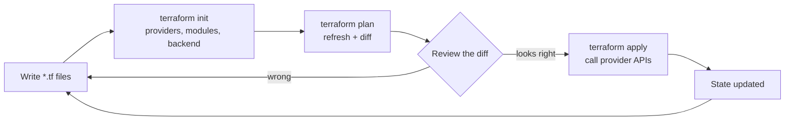

### 1.1 Declarative vs Imperative Infrastructure

Infrastructure as Code (IaC) tools fall into two camps:

1. **Imperative (procedural)**: you write the steps. A Bash script that calls `aws ec2 create-vpc`, then `aws ec2 create-subnet`, then attaches a gateway. If it fails at step three, running it again creates a second VPC unless you wrote defensive "does it exist yet?" checks yourself.
2. **Declarative**: you describe the end state. Terraform compares that description with what it recorded last time (the state) and with what the provider reports now, and works out the steps. Running it twice with no edits does nothing the second time.

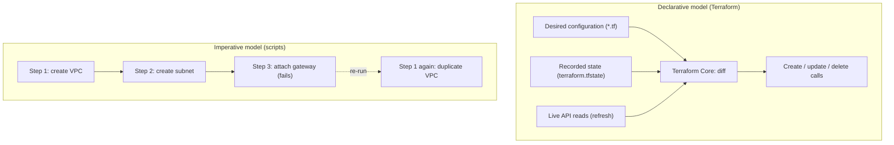

| Dimension | Declarative (Terraform) | Imperative (Bash, AWS CLI, SDK scripts) |
| :--- | :--- | :--- |
| **State tracking** | Built in: `terraform.tfstate` maps config addresses to real IDs | You build it (tags, a database) or you go without |
| **Idempotency** | Re-running with no changes is a no-op | Every step needs an "already exists?" guard |
| **Ordering** | Derived from references between resources | Hard-coded in the script |
| **Drift detection** | `terraform plan -refresh-only` shows out-of-band changes | Custom audit jobs |
| **Deletion** | Remove the block, plan shows `-` destroy | You must write the teardown script |

Terraform is not the only declarative tool. The choice usually comes down to the clouds you target and the language your team wants to write:

| Tool | Language | Scope | State | When it fits |
| --- | --- | --- | --- | --- |
| Terraform / OpenTofu | HCL (also JSON) | Any API with a provider: AWS, Azure, GCP, Kubernetes, GitHub, Datadog, Cloudflare | State file in a backend you choose | Multi-cloud or multi-vendor estates; teams that want a small, reviewable DSL |
| AWS CloudFormation | YAML / JSON | AWS only | Managed by AWS | AWS-only shops that want no state to look after |
| AWS CDK | TypeScript, Python, Java, C#, Go | AWS (synthesises CloudFormation) | CloudFormation | Application teams that prefer general-purpose code |
| Pulumi | TypeScript, Python, Go, C#, Java, YAML | Multi-cloud | Pulumi Cloud or self-managed backend | Teams that need loops and abstractions beyond HCL |
| Ansible | YAML | Mostly configuration of machines | None (procedural modules with idempotency checks) | Configuring OS packages and files inside servers, not provisioning clouds |

### 1.2 Installing Terraform and OpenTofu

Install a single, pinned version per project. The binary is a single static Go executable, so "installing" is just putting the right file on your `PATH`.

```bash
# macOS (Homebrew, HashiCorp tap)
brew tap hashicorp/tap
brew install hashicorp/tap/terraform

# Debian / Ubuntu (HashiCorp apt repository)
wget -O- https://apt.releases.hashicorp.com/gpg \
  | sudo gpg --dearmor -o /usr/share/keyrings/hashicorp-archive-keyring.gpg
echo "deb [signed-by=/usr/share/keyrings/hashicorp-archive-keyring.gpg] https://apt.releases.hashicorp.com $(lsb_release -cs) main" \
  | sudo tee /etc/apt/sources.list.d/hashicorp.list
sudo apt-get update && sudo apt-get install terraform

# Windows (winget)
winget install --id Hashicorp.Terraform

# OpenTofu, the open-source fork (installs the `tofu` binary)
brew install opentofu

# Verify, and enable tab completion for bash/zsh
terraform version
terraform -install-autocomplete
```

Teams that maintain many stacks pin the version per directory with a version manager instead of a global install. `tenv` handles both Terraform and OpenTofu and reads the `required_version` constraint in your code:

```bash
tenv tf install 1.12.2      # exact version used by this repo's CI
tenv tf use 1.12.2
tenv tofu install latest    # OpenTofu side by side
```

You can also skip local installs completely and run the official container image, which is what this repo's [`Dockerfile`](Dockerfile) builds on:

```bash
docker run --rm -v "$PWD:/work" -w /work hashicorp/terraform:1.12.2 version
```

### 1.3 Project Anatomy: Files, Blocks and the Starter Project

Terraform reads every `*.tf` file in the current directory as one configuration. File names carry no meaning to Terraform; the split below is a convention that every reviewer recognises. Sub-directories are not read unless they are called as modules.

```text
learn-terraform/
├── versions.tf            # terraform {} block: required_version, required_providers
├── variables.tf           # input variables with types and validation
├── main.tf                # locals, resources, module calls, check blocks
├── outputs.tf             # values printed after apply and read by tests
├── .terraform.lock.hcl    # exact provider versions + checksums (commit it)
├── .tflint.hcl            # linter configuration used in CI
├── env/
│   ├── dev.tfvars         # example variable values for each environment
│   └── prod.tfvars
├── modules/
│   └── subnet-plan/       # child module: pure computation, no resources
│       ├── versions.tf
│       ├── variables.tf
│       ├── main.tf
│       └── outputs.tf
└── tests/                 # terraform test suites (*.tftest.hcl)
    ├── plan.tftest.hcl
    ├── validation.tftest.hcl
    ├── mocked_apply.tftest.hcl
    └── apply.tftest.hcl
```

Every Terraform file is built from a small set of top-level block types:

| Block | Example | Purpose |
| --- | --- | --- |
| `terraform` | `terraform { required_version = ">= 1.9.0" }` | Settings for Terraform itself: versions, providers, backend |
| `provider` | `provider "aws" { region = "eu-west-1" }` | Configures one instance of a provider plugin |
| `resource` | `resource "random_pet" "suffix" {}` | An object Terraform creates, updates and deletes |
| `data` | `data "aws_caller_identity" "me" {}` | Reads something Terraform does not manage |
| `ephemeral` | `ephemeral "random_password" "db" {}` | A value that exists only during the run (1.10+) |
| `variable` | `variable "project" { type = string }` | An input to the module |
| `locals` | `locals { name_prefix = "..." }` | Named expressions inside the module |
| `output` | `output "name_prefix" { value = ... }` | A value the module returns |
| `module` | `module "subnets" { source = "./modules/subnet-plan" }` | Calls another module |
| `moved`, `removed`, `import` | `moved { from = a.b to = a.c }` | Refactoring and adoption instructions for state |
| `check` | `check "address_space_headroom" { ... }` | Assertions that warn without failing |

Every resource has an **address**: `TYPE.NAME`, plus an index if it uses `count` or `for_each`, plus `module.NAME.` prefixes if it lives in a child module. Addresses are how Terraform links a block of config to an entry in state, and they appear in every plan, state command and error message.

```text
random_pet.suffix                                   # root module, single instance
module.subnets.local.subnet_list                    # a local inside a child module
aws_subnet.this["public-eu-west-1a"]                # for_each instance
module.network.aws_route_table.private[0]           # count instance in a child module
```

### 1.4 Providers and the Plugin Architecture

Terraform is split into two kinds of executables:

- **Terraform Core** (the `terraform` binary, written in Go) parses HCL, evaluates expressions, builds the dependency graph, compares config with state and drives the run. It knows nothing about AWS or GitHub.
- **Providers** are separate binaries, downloaded at `init`, that translate Core's generic requests ("plan this change", "apply it", "read this object") into real API calls. Core launches each provider as a child process and talks to it over gRPC on a local socket, using HashiCorp's `go-plugin` library. The provider plugin protocol has two major versions in use: 5 (SDKv2 providers) and 6 (needed for some Plugin Framework features such as nested attributes).

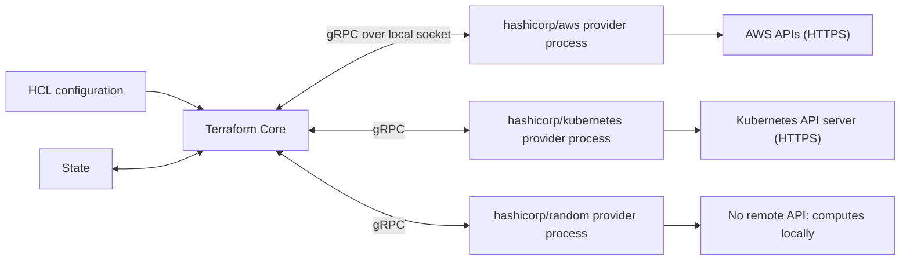

The `required_providers` block names each provider by its **source address**, `[HOSTNAME/]NAMESPACE/TYPE`. The hostname defaults to `registry.terraform.io` (OpenTofu defaults to `registry.opentofu.org`, which mirrors the same namespaces).

```hcl
terraform {
  required_version = ">= 1.9.0"

  required_providers {
    aws = {
      source  = "hashicorp/aws"
      version = "~> 6.0"
    }
  }
}

provider "aws" {
  region = "eu-west-1"

  default_tags {
    tags = {
      Environment = "prod"
      ManagedBy   = "terraform"
    }
  }
}
```

| Line / Block | Role | What happens at runtime |
| :--- | :--- | :--- |
| `terraform { ... }` | Settings for Core | Read before anything else; never evaluated with variables |
| `required_version = ">= 1.9.0"` | Version gate for the CLI | A 1.8 binary stops with `Unsupported Terraform Core version` before planning |
| `required_providers` | Provider requirements | `init` resolves each entry against the registry and the lock file |
| `source = "hashicorp/aws"` | Source address | Expands to `registry.terraform.io/hashicorp/aws` |
| `version = "~> 6.0"` | Version constraint | Allows `>= 6.0, < 7.0`; picks the newest match the lock file permits |
| `provider "aws" { ... }` | Provider configuration | Credentials and region are read when Core first needs the provider |
| `default_tags { ... }` | Provider-level default | Merged into the `tags` of every taggable AWS resource in this configuration |

Version constraint operators are a common source of surprise. The pessimistic operator `~>` allows only the **rightmost** component you wrote to increase:

| Constraint | Allows | Typical use |
| --- | --- | --- |
| `= 6.12.0` or `6.12.0` | Exactly 6.12.0 | Reproducing a bug; rarely in shared code |
| `>= 6.0` | 6.0 and anything newer, including 7.x | `required_version` in reusable modules |
| `~> 6.0` | `>= 6.0, < 7.0` | Root modules: take minors, block majors |
| `~> 6.12.0` | `>= 6.12.0, < 6.13.0` | Freezing a minor while still taking patches |
| `>= 6.5, < 6.20` | A range | Working around a known bad release |
| `!= 6.14.0` | Anything except that release | Combined with another constraint |

Reusable child modules should declare the **minimum** provider version they need (`>= 6.0`) and leave the upper bound to the root module; otherwise two modules with incompatible ranges make the whole configuration impossible to initialise.

### 1.5 `terraform init` and the Dependency Lock File

`terraform init` prepares a working directory. It is safe to run any number of times and is the first command in every CI job.

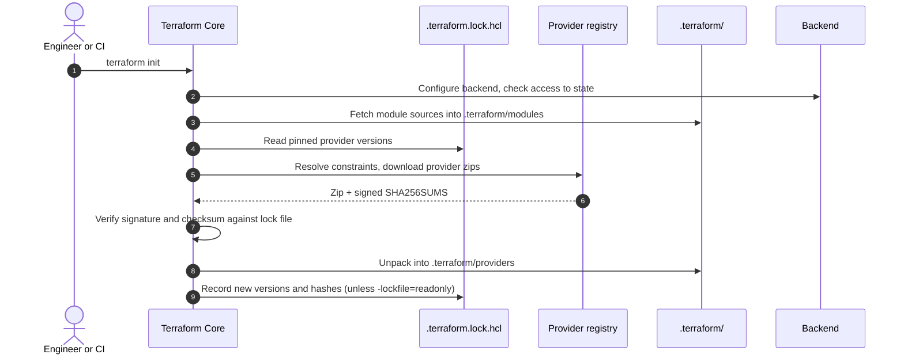

The lock file pins the exact version and the checksums of every provider. This is the starter's lock file, trimmed:

```hcl
provider "registry.terraform.io/hashicorp/random" {
  version     = "3.9.1"
  constraints = "~> 3.7"
  hashes = [
    "h1:...", # hash of the unpacked package for one platform
    "zh:...", # SHA-256 of the release zip for one platform, from the signed checksums file
  ]
}
```

| Field | Meaning |
| --- | --- |
| `version` | The exact version every machine must use until someone runs `init -upgrade` |
| `constraints` | The constraint string that was in force when the version was chosen (informational) |
| `h1:` hashes | Hash of the unpacked provider directory; Terraform adds one per platform it has seen |
| `zh:` hashes | SHA-256 of each platform's zip as published by the provider author |

Useful flags and commands:

```bash
terraform init                         # normal: honour the lock file, add missing providers
terraform init -upgrade                # pick the newest versions the constraints allow, rewrite the lock file
terraform init -lockfile=readonly      # CI: fail instead of changing the lock file
terraform init -backend=false          # skip the backend (lint and test jobs)
terraform init -reconfigure            # ignore the saved backend settings and start fresh
terraform init -migrate-state          # copy state to a new backend after you changed the backend block

# Record hashes for every platform your team runs on, so a lock file
# generated on a Mac also works on Linux CI runners.
terraform providers lock \
  -platform=linux_amd64 -platform=linux_arm64 \
  -platform=darwin_arm64 -platform=windows_amd64

# Share downloaded providers between working directories.
export TF_PLUGIN_CACHE_DIR="$HOME/.terraform.d/plugin-cache"
mkdir -p "$TF_PLUGIN_CACHE_DIR"
```

Commit `.terraform.lock.hcl`; never commit `.terraform/`. The lock file is what makes "it worked on my machine" true in CI, and the checksums stop a tampered or swapped provider binary from being installed silently.

### 1.6 The Dependency Graph

Terraform never runs your blocks top to bottom. It builds a **directed acyclic graph (DAG)** in which every resource, data source, module output, local value and provider configuration is a node, and every reference (`aws_vpc.main.id` inside a subnet) is an edge. It then walks the graph, running independent nodes in parallel (10 at a time by default, set with `-parallelism=N`).

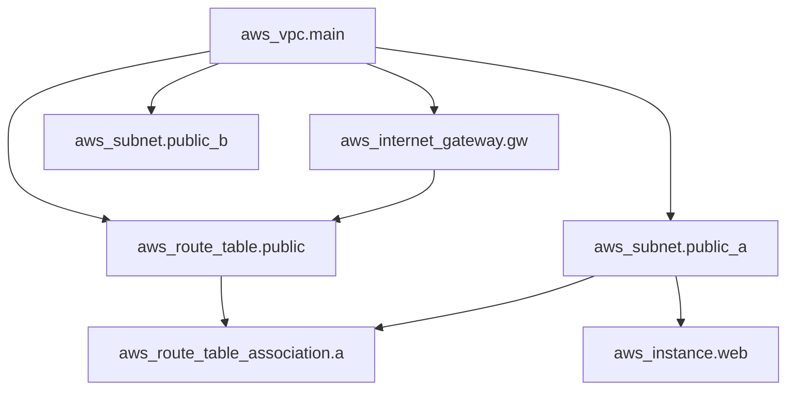

Here `aws_subnet.public_a`, `aws_subnet.public_b` and `aws_internet_gateway.gw` all start as soon as the VPC exists. On destroy the walk is reversed: the instance and association go first, the VPC last.

The starter's graph is small enough to read in full:

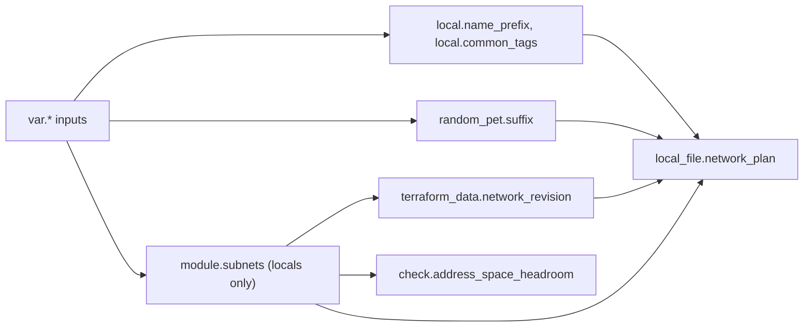

Three rules cover almost every graph question:

1. **References create edges.** If B mentions any attribute of A, B waits for A. This is the preferred way to express order.
2. **`depends_on` adds an edge without a reference.** Use it only for hidden dependencies, for example an IAM policy that must exist before a Lambda function can be invoked, where no attribute of the policy appears in the function. It makes plans more conservative, because Terraform must assume anything about the dependent object might change.
3. **Cycles are fatal.** `Error: Cycle: aws_security_group.a, aws_security_group.b` means each block references the other. Break the loop by moving the mutual part into a separate resource (for security groups, separate `aws_vpc_security_group_ingress_rule` resources).

You can render the real graph of any configuration:

```bash
terraform graph -type=plan | dot -Tsvg > graph.svg   # needs Graphviz
```

### 1.7 The Core Workflow: init, plan, apply, destroy

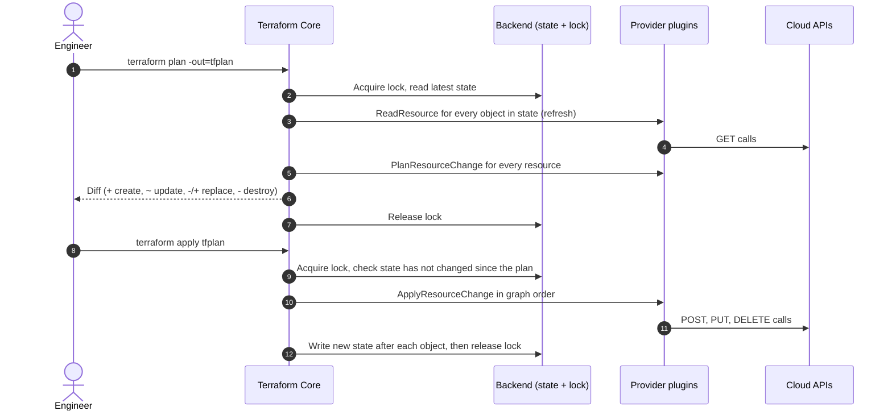

```bash
# Prepare the working directory.
terraform init

# Static checks that need no credentials.
terraform fmt -check -recursive
terraform validate

# Plan and save the exact set of actions to a file.
terraform plan -var-file=env/dev.tfvars -out=tfplan

# Inspect the saved plan as text or as JSON (policy tools read the JSON).
terraform show tfplan
terraform show -json tfplan > plan.json

# Apply exactly what was reviewed. No prompt, because the plan is the approval.
terraform apply tfplan

# Tear everything down. Shows a destroy plan and asks for "yes".
terraform destroy -var-file=env/dev.tfvars
```

| Command / flag | Purpose | Operational practice |
| :--- | :--- | :--- |
| `fmt -check -recursive` | Fails if any file is not in canonical format | First CI step; run `terraform fmt -recursive` locally to fix |
| `validate` | Checks syntax, references and types without calling any API | Needs `init` first (it loads provider schemas) |
| `plan -out=tfplan` | Saves the plan, including the variable values and provider versions used | Mandatory in pipelines: the thing approved is the thing applied |
| `plan -detailed-exitcode` | Exit 0 = no changes, 1 = error, 2 = changes present | Drift detection jobs and "is this upgrade a no-op?" checks |
| `apply tfplan` | Applies a saved plan without re-planning | Fails with `Saved plan is stale` if state changed since the plan |
| `apply -auto-approve` | Plans and applies in one step, no prompt | Only for throwaway sandboxes; it skips human review |
| `apply -replace=ADDRESS` | Forces one object to be destroyed and recreated | Replaces the deprecated `terraform taint` |
| `destroy` | Plans deletion of everything in state | Same as `apply -destroy`; can be blocked by `prevent_destroy` |

Plan output uses a fixed set of symbols. Reviewers should read the symbol before reading the attributes:

| Symbol | Meaning | What to check |
| --- | --- | --- |
| `+` | Create | Names, sizes and tags are what you expect |
| `-` | Destroy | Was the deletion intended? Look for renamed blocks that need a `moved` block |
| `~` | Update in place | Which attribute changes, and whether the provider can do it without downtime |
| `-/+` | Destroy then create (replace) | The attribute marked `# forces replacement` |
| `+/-` | Create then destroy | Same, with `create_before_destroy` in effect |
| `<=` | Read a data source during apply | Its inputs were unknown at plan time |
| `(known after apply)` | Value is computed by the provider | Normal for IDs; suspicious for values you set yourself |

### 1.8 Walking Through the Starter Project

The starter at the root of this repo turns a VPC range, a list of zones and a list of tiers into a subnet plan, tags it, gives it a stable random name and writes it as JSON to `out/`. It needs no cloud credentials, so you can run every command in this stage on a laptop or in CI.

```bash
git clone https://github.com/TheLearningHubOrg/learn-terraform.git
cd learn-terraform
terraform init
terraform plan -var-file=env/dev.tfvars
```

The core of [`main.tf`](main.tf):

```hcl
locals {
  name_prefix = "${var.project}-${var.environment}"

  common_tags = merge(
    {
      Project     = var.project
      Environment = var.environment
      Owner       = var.owner
      ManagedBy   = "terraform"
    },
    var.extra_tags,
  )

  document_path = "${path.root}/out/${local.name_prefix}-network.json"
}

resource "random_pet" "suffix" {
  length = 2

  keepers = {
    project     = var.project
    environment = var.environment
  }
}

module "subnets" {
  source = "./modules/subnet-plan"

  vpc_cidr           = var.vpc_cidr
  availability_zones = var.availability_zones
  tiers              = var.tiers
  newbits            = var.subnet_newbits
}

resource "terraform_data" "network_revision" {
  input            = sha256(jsonencode(module.subnets.subnets))
  triggers_replace = [module.subnets.subnets]
}

resource "local_file" "network_plan" {
  filename        = local.document_path
  file_permission = "0644"

  content = jsonencode({
    name     = "${local.name_prefix}-${random_pet.suffix.id}"
    revision = terraform_data.network_revision.output
    vpc_cidr = var.vpc_cidr
    subnets  = module.subnets.subnets
    tags     = local.common_tags
  })
}
```

| Line / API | Role | What happens at runtime |
| :--- | :--- | :--- |
| `locals { name_prefix = ... }` | A named expression | Evaluated once, as soon as `var.project` and `var.environment` are known |
| `merge({...}, var.extra_tags)` | Combine maps | Keys in later maps win, so callers can override `ManagedBy` |
| `path.root` | Directory of the root module | `.` when you run from the repo root, so the file lands in `./out/` |
| `random_pet.suffix` | A managed resource from `hashicorp/random` | Generates two words such as `quiet-heron` on first apply and stores them in state |
| `keepers = {...}` | Replacement trigger specific to the random provider | Any change to a keeper forces a new suffix; any other edit keeps the old one |
| `module "subnets"` | Call to a local child module | `init` registers it; its outputs are known at plan time because it has no resources |
| `terraform_data.network_revision` | Built-in resource, no provider needed | `input` is copied to `output`; `triggers_replace` forces replacement when the layout changes |
| `local_file.network_plan` | Managed resource from `hashicorp/local` | Writes the file on apply, deletes it on destroy, and recreates it if someone edits it by hand |
| `jsonencode({...})` | Serialise an HCL object | The content is `(known after apply)` in the plan because it includes the random suffix |

The plan has three creates and a set of outputs. Output values that depend only on variables are already known:

```text
Plan: 3 to add, 0 to change, 0 to destroy.

Changes to Outputs:
  + document_path   = "./out/acme-dev-network.json"
  + name_prefix     = "acme-dev"
  + resource_name   = (known after apply)
  + subnet_cidrs    = {
      + data-eu-west-1a    = "10.20.6.0/24"
      + private-eu-west-1a = "10.20.3.0/24"
      + public-eu-west-1a  = "10.20.0.0/24"
      ...
    }
```

Now apply it, look at what Terraform recorded, and prove the second run is a no-op:

```bash
terraform apply -var-file=env/dev.tfvars      # type "yes"
cat out/acme-dev-network.json
terraform state list
# local_file.network_plan
# random_pet.suffix
# terraform_data.network_revision

terraform plan -var-file=env/dev.tfvars -detailed-exitcode
echo $?    # 0: no changes. Idempotency in one number.

terraform destroy -var-file=env/dev.tfvars
```

Finally, run the test suites. They live in `tests/` and are covered in depth in [Stage 5](#54-native-testing-with-terraform-test):

```bash
terraform test
# tests/plan.tftest.hcl... pass
# tests/validation.tftest.hcl... pass
# tests/mocked_apply.tftest.hcl... pass
# tests/apply.tftest.hcl... pass
# Success! 15 passed, 0 failed.
```

### 1.9 Terraform vs OpenTofu

In August 2023 HashiCorp moved Terraform from the Mozilla Public License 2.0 to the Business Source License 1.1, starting with 1.6. The BSL lets you use Terraform freely, including in production, but forbids offering it as part of a product that competes with HashiCorp. In response, a group of vendors forked the last MPL code base as **OpenTofu**, now a Linux Foundation project. IBM completed its acquisition of HashiCorp in 2025; the licence did not change.

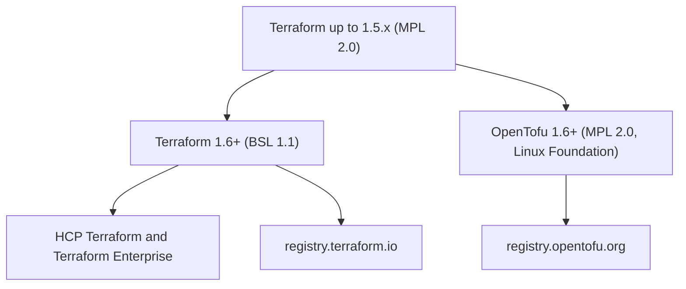

| Dimension | HashiCorp Terraform | OpenTofu |
| :--- | :--- | :--- |
| **Licence** | BSL 1.1 | MPL 2.0 |
| **Governance** | HashiCorp (an IBM company) | Linux Foundation, technical steering committee |
| **CLI** | `terraform` | `tofu`, same subcommands and flags |
| **Default registry** | `registry.terraform.io` | `registry.opentofu.org` |
| **State encryption** | Not built in; rely on backend encryption (S3 SSE-KMS, HCP at rest) | Built-in client-side encryption with an `encryption` block (OpenTofu 1.7+) |
| **Managed service** | HCP Terraform, Terraform Enterprise | Third-party platforms (Spacelift, env0, Scalr, Harness and others) |
| **Language** | HCL with features such as ephemeral values and Terraform Stacks | HCL with its own additions such as provider `for_each` and early variable evaluation |

Both tools read the same `.tf` files and the same state format for the features they share, so switching is mostly a binary swap. The risk sits in features that only one side has. The steps:

```bash
# 1. Install OpenTofu alongside Terraform.
brew install opentofu

# 2. Back up the state before the first run with the new binary.
terraform state pull > backup.tfstate

# 3. Re-initialise. OpenTofu resolves providers from its own registry and
#    rewrites .terraform.lock.hcl with its hashes.
tofu init

# 4. The plan must show no changes. Anything else means a feature gap.
tofu plan -detailed-exitcode
```

OpenTofu's client-side encryption encrypts state and plan files before they reach the backend:

```hcl
# OpenTofu only. Terraform rejects this block.
terraform {
  encryption {
    key_provider "pbkdf2" "main" {
      passphrase = var.state_passphrase
    }

    method "aes_gcm" "main" {
      keys = key_provider.pbkdf2.main
    }

    state {
      method = method.aes_gcm.main
    }

    plan {
      method = method.aes_gcm.main
    }
  }
}
```

In production use a KMS key provider (`aws_kms`, `gcp_kms`, `openbao`) rather than a passphrase, so no human ever holds the key.

### 1.10 Pitfalls

| Pitfall | Symptom | Fix |
| --- | --- | --- |
| Running any command before `init` | `Error: Inconsistent dependency lock file` or `Error: Required plugins are not installed` | Run `terraform init`; in CI make it the first step |
| Lock file generated on one OS only | CI on Linux fails: `the cached package for registry.terraform.io/hashicorp/aws ... does not match any of the checksums recorded in the dependency lock file` | `terraform providers lock -platform=linux_amd64 -platform=darwin_arm64 ...` and commit the result |
| Expecting `~> 6.0.0` to allow 6.1 | `init` keeps 6.0.x forever | `~>` only lets the rightmost written component grow; use `~> 6.0` |
| Committing `.terraform/` | Huge diffs, provider binaries for the wrong OS in the repo | Add `**/.terraform/` to `.gitignore`; commit only `.terraform.lock.hcl` |
| `apply -auto-approve` in a shared pipeline | A plan nobody reviewed deletes a database | `plan -out=tfplan`, human review, then `apply tfplan` |
| Saved plan applied after someone else applied | `Error: Saved plan is stale` | Re-plan; this error is the safety feature working |
| Too new a binary for the team | Colleague sees `Unsupported Terraform Core version` | Pin with `required_version` and a version manager such as `tenv` |
| `depends_on` added "just in case" | Plans show many values as `(known after apply)` and data sources read during apply | Remove it and express order through references |
| Two resource blocks that reference each other | `Error: Cycle: ...` | Extract the mutual part into its own resource |

### 1.11 Best Practices

- **Pin the CLI with `required_version` and a version manager**: every engineer and CI job then runs the same binary.
- **Commit `.terraform.lock.hcl` with hashes for every platform**: it pins providers and blocks swapped binaries.
- **Use `~> MAJOR.MINOR` for providers in root modules and `>=` in child modules**: roots control upgrades, modules stay composable.
- **Always apply a saved plan in automation**: the approval then covers exactly what runs.
- **Keep `fmt -check` and `validate` as the first CI gates**: they fail in seconds and need no credentials.
- **Let references drive ordering**: explicit `depends_on` is a last resort that makes plans less precise.
- **Read the plan symbol first (`+`, `-`, `~`, `-/+`)**: a `-/+` on a stateful resource is the most expensive line in any review.
- **Run `plan -detailed-exitcode` after every upgrade**: exit code 0 proves the upgrade changed nothing.

### 1.12 Hands-on Exercise

Change the starter to use four zones and confirm the result without applying anything.

1. Copy `env/dev.tfvars` to `env/four-zones.tfvars` and add `availability_zones = ["eu-west-1a", "eu-west-1b", "eu-west-1c", "eu-west-1d"]`.
2. Run `terraform plan -var-file=env/four-zones.tfvars`.
3. Answer: how many subnets are planned, and what CIDR does `private-eu-west-1a` get?

Expected output: `subnet_cidrs` lists 12 entries and `private-eu-west-1a = "10.20.4.0/24"`, because the private tier now starts after four public blocks (block number `1 * 4 + 0 = 4`). The allocation rule is in [`modules/subnet-plan/main.tf`](modules/subnet-plan/main.tf); [`tests/plan.tftest.hcl`](tests/plan.tftest.hcl) shows how to assert on it. As a stretch, add a `run` block to that file that asserts your answer, and run `terraform test`.

[Back to top ⤴️](#-table-of-contents)

---

## 2. Stage 2: HCL Language, Variables, Expressions & Meta-Arguments

HCL is a small configuration language with real types, expressions and functions, but no loops in the imperative sense, no mutable variables and no user-defined functions. This stage covers the whole language as Terraform uses it. Prerequisite: Stage 1. Afterwards you can write typed, validated inputs, build collections with `for` expressions, create many resources from one block, and guard a configuration with conditions that fail early with clear messages.

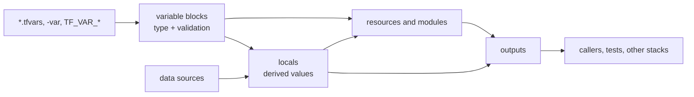

### 2.1 HCL Syntax: Blocks, Arguments, Expressions and Comments

A Terraform file is a list of **blocks**. A block has a type, zero or more quoted labels, and a body in braces. Inside the body you write **arguments** (`name = expression`) and **nested blocks**.

```hcl
# Block type "resource", labels "local_file" and "network_plan".
resource "local_file" "network_plan" {
  # Argument: name = expression
  filename = "${path.root}/out/plan.json"

  // C-style line comments also work, and so do /* block comments */.
  content = jsonencode({ ok = true })

  # Nested block, no "=" sign.
  lifecycle {
    create_before_destroy = true
  }
}
```

| Construct | Example | Notes |
| --- | --- | --- |
| String | `"eu-west-1"` | Double quotes only; single quotes are a syntax error |
| Interpolation | `"${var.project}-${var.environment}"` | Only inside strings; a bare `var.project` needs no `${}` |
| Directive | `"%{ if var.public }public%{ else }private%{ endif }"` | `if` and `for` inside templates |
| Heredoc | `<<-EOT ... EOT` | The `-` strips the common leading indentation |
| Number | `8`, `0.5` | One number type; no int/float split |
| Bool | `true`, `false` | Lowercase |
| List / tuple | `["a", "b"]` | Commas required; trailing comma allowed |
| Map / object | `{ Project = "acme", "Cost-Center" = "42" }` | Quote keys that are not valid identifiers |
| Null | `null` | Means "argument not set": the provider default applies |
| Reference | `var.x`, `local.y`, `module.m.out`, `random_pet.suffix.id`, `data.aws_vpc.main.id` | Every reference is a graph edge |

Heredocs are how multi-line content such as policies or scripts usually appears:

```hcl
locals {
  motd = <<-EOT
    Welcome to ${var.project} (${var.environment}).
    %{~ for tier in var.tiers }
    - tier: ${tier}
    %{~ endfor }
  EOT
}
```

`terraform fmt` rewrites files into one canonical layout (two-space indent, aligned `=`). Treat its output as non-negotiable so that diffs only ever show real changes.

### 2.2 Types and Type Constraints

Every value has a type, and every `variable` should declare one. Terraform converts values automatically where it can (`"8"` to `8`, a tuple to a list) and fails with a clear error where it cannot.

| Kind | Types | Example constraint |
| --- | --- | --- |
| Primitive | `string`, `number`, `bool` | `type = number` |
| Collection (all elements one type) | `list(T)`, `set(T)`, `map(T)` | `type = map(string)` |
| Structural (named or positional fields) | `object({...})`, `tuple([...])` | `type = object({ name = string, size = number })` |
| Wildcard | `any` | Lets Terraform infer; use only when the module truly accepts anything |

Objects can mark attributes as optional and give them defaults (1.3+). This makes large inputs ergonomic without losing type safety:

```hcl
variable "cluster_config" {
  description = "Node pool settings"
  type = object({
    cluster_name  = string
    node_count    = optional(number, 3)
    instance_type = optional(string, "m7g.large")
    zones         = list(string)
    auto_scaling = optional(object({
      min_nodes = number
      max_nodes = number
    }), { min_nodes = 1, max_nodes = 5 })
    tags = optional(map(string), {})
  })
}
```

A caller can now pass only the required fields:

```hcl
cluster_config = {
  cluster_name = "payments"
  zones        = ["eu-west-1a", "eu-west-1b"]
}
# node_count = 3, instance_type = "m7g.large", auto_scaling = {1, 5}, tags = {}
```

Three type rules trip people up:

- `list` keeps order and allows duplicates; `set` has no order and no duplicates, and you cannot index it (`toset(...)[0]` fails). `for_each` accepts only maps and sets of strings.
- Object types are **structural**: an object with extra attributes converts to a smaller object type by dropping the extras silently. A typo in an optional attribute name is therefore ignored, not rejected. Validate critical inputs explicitly.
- `map(any)` must still have a single element type after conversion. Mixing `{ a = "x", b = 1 }` works (both become strings), but `{ a = "x", b = ["y"] }` fails with `all map elements must have the same type`.

### 2.3 Input Variables, Validation and Sensitive Values

Variables are the module's public API. A good variable has a type, a description, a default only if one is genuinely safe, and validation for anything with a restricted shape. These come from the starter's [`variables.tf`](variables.tf):

```hcl
variable "environment" {
  description = "Deployment environment."
  type        = string
  default     = "dev"

  validation {
    condition     = contains(["dev", "staging", "prod"], var.environment)
    error_message = "The environment must be one of: dev, staging, prod."
  }
}

variable "owner" {
  description = "Team that owns the stack. Required in prod."
  type        = string
  default     = ""

  # Cross-variable validation (Terraform 1.9+): the rule reads var.environment.
  validation {
    condition     = var.environment != "prod" || length(trimspace(var.owner)) > 0
    error_message = "The owner must be set when environment is prod."
  }
}

variable "vpc_cidr" {
  description = "IPv4 range for the whole network, e.g. 10.20.0.0/16."
  type        = string
  default     = "10.20.0.0/16"

  validation {
    condition     = can(cidrhost(var.vpc_cidr, 0)) && can(regex("^[0-9.]+/(1[6-9]|2[0-4])$", var.vpc_cidr))
    error_message = "The vpc_cidr must be a valid IPv4 CIDR block with a prefix between /16 and /24."
  }
}
```

| Attribute | Effect |
| :--- | :--- |
| `type` | Converts the incoming value or fails with `Invalid value for input variable` |
| `default` | Makes the variable optional. Without one, Terraform prompts (interactive) or fails (`-input=false`) |
| `description` | Shown by tools such as `terraform-docs` and in prompts |
| `validation { condition, error_message }` | Evaluated during plan before any resource that uses the variable; several blocks are allowed |
| `sensitive = true` | Redacts the value in plan and apply output. **It is still stored in plain text in state** |
| `nullable = false` | Passing `null` uses the default instead of null |
| `ephemeral = true` | The value may be used only in ephemeral contexts and is never written to state or plan files (1.10+) |

`can(expr)` returns `false` instead of raising an error, which is how the CIDR rule tests "is this parseable?" without crashing. The error a user sees when validation fails names the variable and the rule:

```text
Error: Invalid value for variable

  on variables.tf line 11:
  11: variable "environment" {
    ├────────────────
    │ var.environment is "qa"

The environment must be one of: dev, staging, prod.
```

Values can come from many places. When the same variable is set more than once, the later source in this list wins:

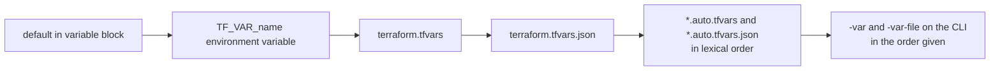

```bash
export TF_VAR_project=acme                       # environment variable
terraform plan -var-file=env/prod.tfvars         # explicit file
terraform plan -var-file=env/dev.tfvars -var environment=staging   # -var wins over the file before it
```

Keep secrets out of `.tfvars` files that are committed. Pass them as `TF_VAR_*` from the CI secret store, or better, read them at run time with an ephemeral resource ([3.9](#39-protecting-state-encryption-access-and-secrets)).

### 2.4 Locals and Outputs

**Locals** name an expression so you write it once. They are evaluated lazily, can reference each other, and are visible only inside the module that declares them.

```hcl
locals {
  name_prefix = "${var.project}-${var.environment}"

  common_tags = merge(
    {
      Project     = var.project
      Environment = var.environment
      Owner       = var.owner
      ManagedBy   = "terraform"
    },
    var.extra_tags,
  )
}
```

**Outputs** are the module's return values. In the root module they print after apply and can be read with `terraform output`; in a child module they are the only way the caller can see inside.

```hcl
output "subnet_cidrs" {
  description = "Map of tier-zone key to CIDR block."
  value       = { for key, s in module.subnets.subnets : key => s.cidr }
}

output "db_password" {
  value     = random_password.db.result
  sensitive = true # required: Terraform refuses to output a sensitive value without it
}
```

```bash
terraform output                       # all outputs, sensitive ones shown as <sensitive>
terraform output -raw document_path    # one value, no quotes: good for scripts
terraform output -json | jq '.subnet_cidrs.value'
```

| Use a... | When |
| --- | --- |
| `variable` | The value comes from outside the module and differs per caller or environment |
| `local` | The value is derived from other values, or is a constant repeated more than once |
| `output` | A caller, a test, a script or another stack needs the value |

Avoid locals that simply rename a variable (`local.env = var.environment`). They add a hop for every reader and hide where the value comes from.

### 2.5 Expressions: Conditionals, `for`, Splat and `dynamic` Blocks

**Conditionals** use `condition ? true_value : false_value`. Both branches must have compatible types.

```hcl
locals {
  instance_type = var.environment == "prod" ? "m7g.large" : "t4g.small"
  backup_days   = var.environment == "prod" ? 35 : 1
}
```

**`for` expressions** transform collections. Square brackets produce a list, braces produce a map, and an `if` clause filters.

```hcl
variable "users" {
  type = list(object({
    username = string
    role     = string
    active   = bool
  }))
  default = [
    { username = "ana", role = "admin", active = true },
    { username = "raj", role = "dev", active = true },
    { username = "lee", role = "admin", active = false },
  ]
}

locals {
  # List: ["ana"]
  admin_usernames = [for u in var.users : u.username if u.role == "admin" && u.active]

  # Map: { ana = "admin", raj = "dev", lee = "admin" }
  user_role_map = { for u in var.users : u.username => u.role }

  # Grouping mode with "...": { admin = ["ana", "lee"], dev = ["raj"] }
  users_by_role = { for u in var.users : u.role => u.username... }
}
```

The starter uses grouping mode to list CIDRs per tier, from [`outputs.tf`](outputs.tf):

```hcl
output "subnets_by_tier" {
  value = { for s in module.subnets.subnet_list : s.tier => s.cidr... }
}
# { data = ["10.20.6.0/24", ...], private = [...], public = [...] }
```

Without `...`, two elements with the same key raise `Duplicate object key`. That error is useful: it tells you your key is not unique, which matters again when you feed the map to `for_each`.

Nested `for` plus `flatten()` turns a two-level structure into one list. This is the subnet allocation in [`modules/subnet-plan/main.tf`](modules/subnet-plan/main.tf):

```hcl
locals {
  zone_count = length(var.availability_zones)

  subnet_list = flatten([
    for tier_index, tier in var.tiers : [
      for zone_index, zone in var.availability_zones : {
        key  = "${tier}-${zone}"
        tier = tier
        zone = zone
        cidr = cidrsubnet(var.vpc_cidr, var.newbits, tier_index * local.zone_count + zone_index)
      }
    ]
  ])
}
```

| Expression | Role | Result for 3 tiers x 3 zones |
| --- | --- | --- |
| `for tier_index, tier in var.tiers` | Iterate a list with its index | `0 public`, `1 private`, `2 data` |
| inner `for zone_index, zone in ...` | Iterate zones for each tier | A list of 3 objects per tier |
| `tier_index * local.zone_count + zone_index` | Unique block number | 0..8 |
| `cidrsubnet(var.vpc_cidr, var.newbits, n)` | Carve block `n` of size `/prefix+newbits` | `10.20.0.0/24` ... `10.20.8.0/24` |
| `flatten([...])` | Remove one level of nesting | One list of 9 objects |

**Splat** `[*]` is shorthand for a `for` that picks one attribute from every element:

```hcl
output "subnet_ids" {
  value = aws_subnet.public[*].id                       # count-based resource
}

output "subnet_ids_from_map" {
  value = [for s in aws_subnet.this : s.id]             # for_each-based: splat does not work on maps
}
```

**`dynamic` blocks** generate repeated nested blocks inside a resource. They are for nested blocks only; to create several resources use `for_each` on the resource itself.

```hcl
variable "ingress_rules" {
  type = list(object({
    port        = number
    description = string
    cidr_blocks = list(string)
  }))
  default = [
    { port = 80, description = "HTTP", cidr_blocks = ["0.0.0.0/0"] },
    { port = 443, description = "HTTPS", cidr_blocks = ["0.0.0.0/0"] },
  ]
}

resource "aws_security_group" "web" {
  name   = "web-tier"
  vpc_id = aws_vpc.main.id

  dynamic "ingress" {
    for_each = var.ingress_rules
    content {
      description = ingress.value.description
      from_port   = ingress.value.port
      to_port     = ingress.value.port
      protocol    = "tcp"
      cidr_blocks = ingress.value.cidr_blocks
    }
  }
}
```

| Element | Mechanics |
| :--- | :--- |
| `dynamic "ingress"` | Name of the nested block type to generate |
| `for_each` | Any collection; one nested block per element |
| `content { ... }` | Body of each generated block |
| `ingress.value`, `ingress.key` | The iterator, named after the block unless you set `iterator = rule` |

For new AWS code, prefer the standalone `aws_vpc_security_group_ingress_rule` resource with `for_each` over inline `ingress` blocks: each rule then has its own address, and adding one rule never rewrites the others.

### 2.6 Built-in Functions and `terraform console`

Terraform ships around a hundred pure functions. You cannot define your own, but providers can add functions (1.8+), called as `provider::NAME::FUNCTION(...)`. The fastest way to learn any function is the REPL, which loads the current configuration so you can evaluate real variables and locals:

```bash
terraform console -var project=acme
> cidrsubnet("10.20.0.0/16", 8, 3)
"10.20.3.0/24"
> cidrhost("10.20.3.0/24", 10)
"10.20.3.10"
> local.name_prefix
"acme-dev"
> merge({ a = 1, b = 2 }, { b = 3 })
{
  "a" = 1
  "b" = 3
}
> cidrsubnet("10.20.0.0/16", 8, 300)
Error: Call to function "cidrsubnet" failed: prefix extension of 8 does not accommodate a subnet numbered 300.
```

The functions used most in real code:

| Group | Functions | Example |
| --- | --- | --- |
| Collections | `length`, `concat`, `flatten`, `merge`, `distinct`, `keys`, `values`, `lookup`, `zipmap`, `setproduct`, `contains`, `alltrue`, `anytrue` | `zipmap(["a","b"], [1,2])` → `{ a = 1, b = 2 }` |
| Strings | `format`, `join`, `split`, `replace`, `lower`, `trimspace`, `startswith`, `endswith`, `regex`, `regexall` | `format("%s-%03d", "web", 7)` → `"web-007"` |
| Network | `cidrsubnet`, `cidrsubnets`, `cidrhost`, `cidrnetmask` | `cidrsubnets("10.0.0.0/16", 4, 4, 8)` → three blocks of mixed sizes |
| Encoding | `jsonencode`, `jsondecode`, `yamlencode`, `yamldecode`, `base64encode`, `csvdecode` | `jsondecode(file("cfg.json")).version` |
| Files | `file`, `fileexists`, `templatefile`, `filesha256`, `fileset` | `templatefile("${path.module}/user_data.sh.tftpl", { port = 8080 })` |
| Errors | `try`, `can` | `try(var.settings.port, 8080)` |
| Type conversion | `tostring`, `tonumber`, `tolist`, `toset`, `tomap` | `toset(var.zones)` for `for_each` |
| Hashing | `sha256`, `md5`, `uuidv5` | `sha256(jsonencode(module.subnets.subnets))` in the starter |

A worked block that combines several of them:

```hcl
variable "extra_tags" {
  type    = map(string)
  default = {}
}

locals {
  raw_subnets  = [["10.0.1.0/24", "10.0.2.0/24"], ["10.0.3.0/24"]]
  flat_subnets = flatten(local.raw_subnets) # ["10.0.1.0/24", "10.0.2.0/24", "10.0.3.0/24"]

  combined_tags = merge(
    { Owner = "platform" },
    { Project = "nebula" },
    var.extra_tags,
  )

  # try() returns the first argument that evaluates without an error.
  raw_config     = "{\"version\": 2}"
  config_version = try(jsondecode(local.raw_config).version, 1) # 2

  # templatefile renders a separate file with its own variables.
  user_data = templatefile("${path.module}/templates/user_data.sh.tftpl", {
    port    = 8080
    project = "nebula"
  })
}
```

`try()` is clearer than `can(x) ? x : y` for defaults, but use it narrowly: wrapping a whole expression in `try` also hides typos, because a misspelt attribute is just another error it swallows.

Functions are evaluated during plan when their inputs are known. Functions that read files (`file`, `templatefile`) read them at plan time from the machine running Terraform, so the file must exist in the working directory; you cannot read a file that a resource creates during the same apply.

### 2.7 Meta-Arguments: `count`, `for_each`, `provider`, `depends_on` and `lifecycle`

Meta-arguments work on any resource (and most work on modules). They control how many instances exist and how Terraform treats them.

`count` creates N instances addressed by number. `for_each` creates one instance per map key or set element, addressed by that key. The difference matters the day you remove an item from the middle:

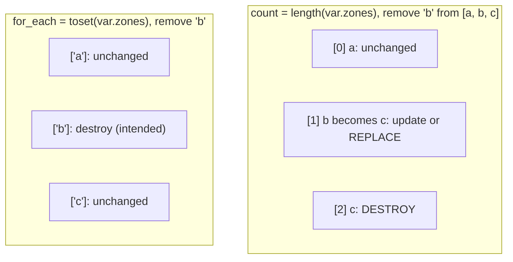

```hcl
# count: good for "zero or one" and for identical copies.
resource "aws_cloudwatch_log_group" "audit" {
  count             = var.enable_audit ? 1 : 0
  name              = "/acme/${var.environment}/audit"
  retention_in_days = 90
}

# for_each: good for anything with an identity. Keys come from the starter's module.
resource "aws_subnet" "this" {
  for_each = module.subnets.subnets

  vpc_id            = aws_vpc.main.id
  cidr_block        = each.value.cidr
  availability_zone = each.value.zone
  tags              = merge(local.common_tags, { Name = "${local.name_prefix}-${each.key}", Tier = each.value.tier })
}

# Reference a conditional single instance safely.
output "audit_log_group" {
  value = one(aws_cloudwatch_log_group.audit[*].name) # null when count = 0
}
```

| Meta-argument | Values | Notes |
| --- | --- | --- |
| `count` | A whole number known at plan time | `count.index` inside the block |
| `for_each` | A map, or a set of strings, with keys known at plan time | `each.key`, `each.value`; values may be unknown, keys may not |
| `provider` | `aws.us_west_2` | Picks a non-default provider configuration ([Stage 5](#52-multi-account-and-multi-region-architectures)) |
| `depends_on` | List of resources or modules | Hidden dependencies only |
| `lifecycle` | Nested block, see below | Changes how replacement and drift are handled |

The `lifecycle` block:

| Argument | What it does | Typical use |
| --- | --- | --- |
| `create_before_destroy = true` | Builds the replacement before deleting the old object | Launch templates, certificates, anything behind a load balancer. Fails if the name must be unique |
| `prevent_destroy = true` | Any plan that would destroy the object fails, including `terraform destroy` | Databases, KMS keys, state buckets. Removing the block from config removes the protection |
| `ignore_changes = [tags["LastScanned"]]` | Ignores drift on listed attributes | Attributes managed by another system, such as an autoscaler's `desired_capacity` |
| `replace_triggered_by = [terraform_data.network_revision]` | Replaces this resource when the referenced object or attribute changes | Rolling instances when a config hash changes |
| `precondition` / `postcondition` | Assertions before planning / after applying this resource | See [2.8](#28-custom-conditions-validation-precondition-postcondition-and-check) |

### 2.8 Custom Conditions: Validation, Precondition, Postcondition and Check

Terraform has four places to put an assertion, and they differ in what they can see and what happens when they fail:

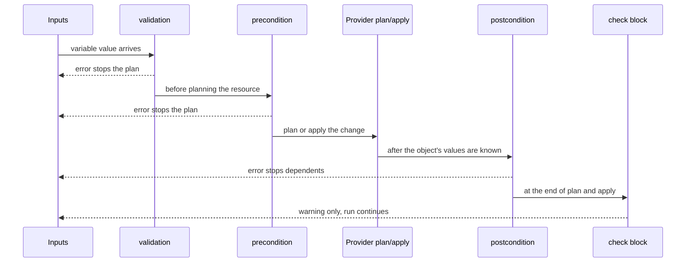

| Kind | Lives in | Can reference | On failure | Use for |
| --- | --- | --- | --- | --- |
| `validation` | `variable` | That variable and, from 1.9, other variables, locals and data | Plan fails, error points at the variable | Input shape and allowed values |
| `precondition` | `lifecycle` of a resource, data source or `output` | Anything in the module | Plan fails before that object is planned | Assumptions about other objects, such as "the AMI must be arm64" |
| `postcondition` | `lifecycle` of a resource or data source | `self` plus anything | Fails after the object is planned or applied; dependents are not processed | Guarantees about what the provider returned |
| `check` | Top-level block | Anything; may contain a scoped data source | Warning, never an error | Health checks and "should" rules |

The starter uses three of them. A postcondition on the file guarantees the rendered document is complete, and a check warns when subnets consume more than half the VPC:

```hcl
resource "local_file" "network_plan" {
  # ...
  lifecycle {
    postcondition {
      condition     = length(jsondecode(self.content).subnets) == length(var.tiers) * length(var.availability_zones)
      error_message = "The rendered document must list one subnet per tier per zone."
    }
  }
}

check "address_space_headroom" {
  assert {
    condition     = module.subnets.used_addresses * 2 <= module.subnets.total_addresses
    error_message = "Subnets use more than half of ${var.vpc_cidr}; leave room to grow."
  }
}
```

Try the check: one tier of `/18` blocks across three zones uses 75% of a `/16`, so the plan succeeds but warns.

```bash
terraform plan -var project=acme -var 'tiers=["app"]' -var subnet_newbits=2
# Warning: Check block assertion failed
#   module.subnets.total_addresses is 65536
#   module.subnets.used_addresses is 49152
# Subnets use more than half of 10.20.0.0/16; leave room to grow.
```

A precondition example that checks an assumption about something Terraform reads:

```hcl
data "aws_ami" "app" {
  most_recent = true
  owners      = ["amazon"]

  filter {
    name   = "name"
    values = ["al2023-ami-*-arm64"]
  }
}

resource "aws_instance" "app" {
  ami           = data.aws_ami.app.id
  instance_type = "t4g.small"

  lifecycle {
    precondition {
      condition     = data.aws_ami.app.architecture == "arm64"
      error_message = "t4g instances need an arm64 AMI."
    }
  }
}
```

### 2.9 Data Sources

A `data` block reads an object that Terraform does not manage: the current account ID, the newest AMI, a VPC created by another team. Data sources never create or delete anything.

```hcl
data "aws_caller_identity" "current" {}

data "aws_region" "current" {}

data "aws_vpc" "shared" {
  tags = {
    Name = "shared-services"
  }
}

locals {
  state_bucket = "acme-tfstate-${data.aws_caller_identity.current.account_id}-${data.aws_region.current.region}"
}
```

Terraform reads data sources during plan, so their results feed the diff. The exception: if any argument of the data source depends on a value that is `(known after apply)`, or the data block has `depends_on` pointing at a resource with pending changes, the read is deferred to apply and the plan shows `<= read (data resources)`. Everything downstream then becomes unknown too, which makes plans hard to review. Keep data source arguments independent of resources created in the same run whenever you can.

| Need | Use |
| --- | --- |
| Look up an object someone else manages | `data` block |
| Bring an existing object under management | `import` block ([3.7](#37-importing-existing-infrastructure)) |
| Read another stack's outputs | `terraform_remote_state` or a parameter store ([5.3](#53-cross-stack-data-sharing-via-terraform_remote_state-and-ssm)) |
| A value that must never be stored | `ephemeral` resource ([3.9](#39-protecting-state-encryption-access-and-secrets)) |

### 2.10 Pitfalls

| Pitfall | Symptom | Fix |
| --- | --- | --- |
| `for_each` over a list | `The given "for_each" argument value is unsuitable: ... a set of strings or a map, and you have provided a value of type tuple` | `for_each = toset(var.names)` or build a map with a `for` expression |
| `for_each` keys depend on a resource attribute | `The "for_each" map includes keys derived from resource attributes that cannot be determined until apply` | Build keys from variables or static values; only values may be unknown |
| Removing a middle element from a `count` list | Plan shows updates and destroys for every later index | Switch to `for_each`, with `moved` blocks to keep existing objects ([3.6](#36-refactoring-without-downtime-moved-and-removed-blocks)) |
| `sensitive = true` treated as encryption | Secret found in plain text in `terraform.tfstate` | Encrypt and restrict the backend; use ephemeral values or write-only attributes |
| Typo in an optional object attribute | Value silently ignored, default used | Add a `validation` that checks `keys()` against an allowed list, or avoid `optional` for critical fields |
| Duplicate keys in a `for` map | `Duplicate object key` | Make the key unique or use grouping mode `...` |
| `try()` around a large expression | A misspelt attribute quietly returns the fallback | Wrap only the part that may legitimately fail |
| Interpolation-only strings `"${var.x}"` | TFLint warning `terraform_deprecated_interpolation` | Write `var.x` |
| Data source depends on a new resource | Plan full of `(known after apply)` and `<= read` | Pass known inputs, or split into two stacks |
| Single quotes in HCL | `Invalid character; Single quotes are not valid` | Use double quotes |

### 2.11 Best Practices

- **Type every variable, and prefer specific types over `any`**: errors then appear at the input, not deep inside a resource.
- **Validate inputs where they enter the module**: one `validation` block saves every caller from a confusing provider error later.
- **Use `for_each` with stable string keys for anything with an identity**: removing one item then touches only that item.
- **Reserve `count` for on/off toggles and identical copies**: `count = var.enabled ? 1 : 0` plus `one(...)` to read it.
- **Keep locals for derived values, not renames**: readers should reach the source in one hop.
- **Put "must" rules in validation or preconditions and "should" rules in `check` blocks**: warnings for advice, errors for safety.
- **Explore expressions in `terraform console` before committing them**: it evaluates against your real configuration.
- **Never put secrets in committed `.tfvars`**: use CI secrets, a vault, or ephemeral resources.

### 2.12 Hands-on Exercise

Add an optional "edge" tier to the starter that only appears in production.

1. In [`variables.tf`](variables.tf), keep `tiers` as is and add a `bool` variable `enable_edge_tier` with default `false`.
2. In [`main.tf`](main.tf), compute `local.effective_tiers = var.enable_edge_tier ? concat(var.tiers, ["edge"]) : var.tiers` and pass it to the module instead of `var.tiers`. Update the postcondition and the `subnet_newbits` validation reasoning accordingly.
3. Add a validation to `enable_edge_tier` that rejects `true` unless `var.environment == "prod"` (cross-variable validation).
4. Add a `run` block to [`tests/plan.tftest.hcl`](tests/plan.tftest.hcl) that sets `environment = "prod"`, `owner = "platform-team"`, `enable_edge_tier = true` and asserts `length(output.subnet_cidrs) == 12` and `output.subnet_cidrs["edge-eu-west-1a"] == "10.20.9.0/24"`. Add a second run in [`tests/validation.tftest.hcl`](tests/validation.tftest.hcl) that expects the failure in dev.

Expected output: `terraform test` reports two more passing runs. Appending the new tier at the end of the list is what keeps every existing CIDR unchanged; put it first and all nine existing blocks move.

[Back to top ⤴️](#-table-of-contents)

---

## 3. Stage 3: State, Backends, Import & Drift

State is the part of Terraform that turns a set of files into a system that can update and delete what it created. This stage explains what is in the state file, where to keep it, how locking works, and how to change state safely: renaming, removing, importing and reconciling drift. Prerequisites: Stages 1 and 2. Afterwards you can set up a locked remote backend, refactor a configuration without recreating anything, and adopt resources that were built by hand.

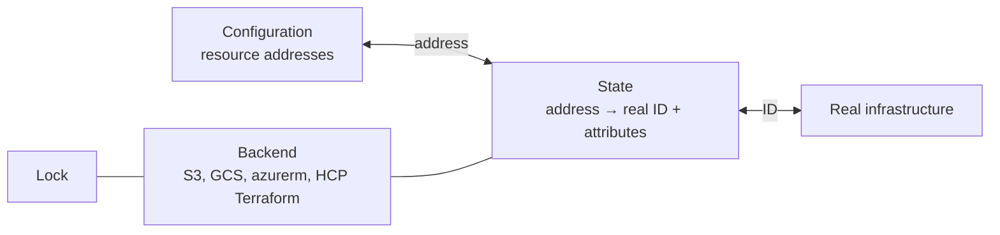

### 3.1 What State Is and Why Terraform Needs It

The configuration says `random_pet.suffix` should exist. The API knows about an object with some ID. Only the state connects the two. Without it Terraform could not tell "create a new bucket" from "this bucket already exists and is mine", could not delete objects whose blocks you removed, and would have to query every object in the account to plan.

After `terraform apply` the starter's local state (`terraform.tfstate`) looks like this, trimmed:

```json
{
  "version": 4,
  "terraform_version": "1.12.2",
  "serial": 3,
  "lineage": "6f1d2c1e-8a0b-4a3c-9a55-0c2f5d7e9b10",
  "outputs": {
    "name_prefix": { "value": "acme-dev", "type": "string" }
  },
  "resources": [
    {
      "mode": "managed",
      "type": "random_pet",
      "name": "suffix",
      "provider": "provider[\"registry.terraform.io/hashicorp/random\"]",
      "instances": [
        {
          "schema_version": 0,
          "attributes": {
            "id": "quiet-heron",
            "keepers": { "environment": "dev", "project": "acme" },
            "length": 2,
            "prefix": null,
            "separator": "-"
          }
        }
      ]
    }
  ]
}
```

| Field | Meaning |
| --- | --- |
| `version` | State **format** version (4 for all of Terraform 1.x) |
| `terraform_version` | Version that last wrote the file. Older binaries refuse to read state written by much newer ones |
| `serial` | Incremented on every write. Backends use it to reject a write based on an older copy |
| `lineage` | UUID assigned when the state is first created. A state with a different lineage is a different state, and Terraform refuses to overwrite it with `state push` |
| `outputs` | Root module output values |
| `resources[].mode` | `managed` (resource) or `data` (data source) |
| `resources[].provider` | Which provider configuration owns the object; needed to destroy it even after the block is gone |
| `instances[].attributes` | Every attribute the provider returned, **including secrets** |
| `instances[].index_key` | The `count` index or `for_each` key, when present |
| `instances[].dependencies` | Addresses this object depended on at apply time, used to order a destroy |

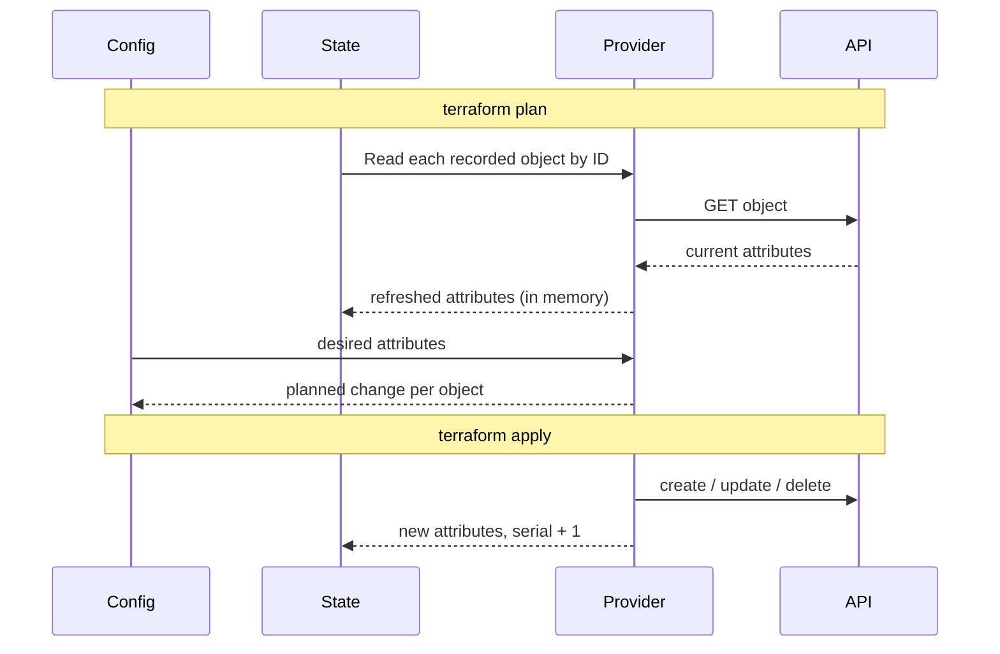

Treat the state file as a database that Terraform owns: never edit the JSON by hand. Every legitimate change has a command or a block, covered below.

### 3.2 Local vs Remote Backends

A **backend** decides where state is stored and whether it can be locked. The default `local` backend writes `terraform.tfstate` next to your code, which is fine for learning and wrong for anything shared.

| Backend | Locking | Encryption at rest | Notes |
| --- | --- | --- | --- |
| `local` | Process-level only | None | Single user, throwaway work, the starter project |
| `s3` | `use_lockfile = true` (S3 conditional writes); DynamoDB is deprecated | SSE-S3 or SSE-KMS | The default choice on AWS; enable bucket versioning |
| `gcs` | Built in (lock object) | Google-managed or CMEK | Enable object versioning |
| `azurerm` | Built in (blob lease) | Storage service encryption | Use Entra ID auth instead of access keys |
| `cloud` block (HCP Terraform / Terraform Enterprise) | Built in | Built in | Also runs plans remotely, stores history, enforces policy |
| `pg` | Postgres advisory locks | Database-level | Teams that already run Postgres and want no cloud dependency |
| `kubernetes` | Lease object | Secret encryption of the cluster | State stored as a Secret; size-limited |
| `http` | Optional, via LOCK/UNLOCK endpoints | Depends on the server | GitLab's managed Terraform state uses this |

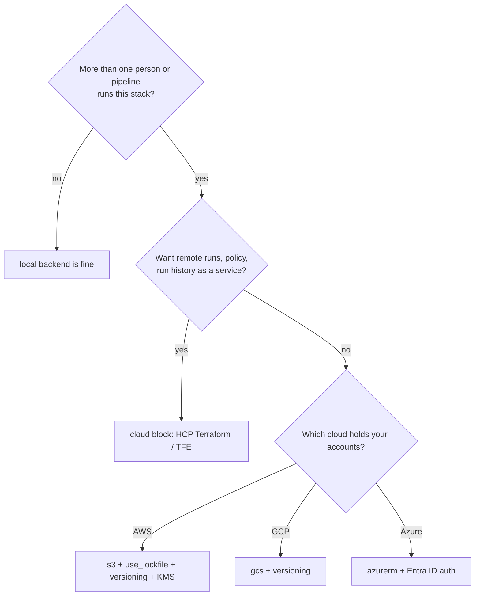

A backend block cannot use variables, locals or data sources, because it must be read before anything else is evaluated. To keep environment-specific values out of the code, use **partial configuration**: leave arguments out of the block and supply them at `init`.

```hcl
# backend.tf: only what is the same everywhere
terraform {
  backend "s3" {
    key          = "network/terraform.tfstate"
    use_lockfile = true
    encrypt      = true
  }
}
```

```hcl
# backends/prod.s3.tfbackend
bucket     = "acme-tfstate-prod-123456789012"
region     = "eu-west-1"
kms_key_id = "alias/tfstate"
```

```bash
terraform init -backend-config=backends/prod.s3.tfbackend
```

### 3.3 Remote State on S3 with Native Locking

The S3 backend stores the state object at `key` and, with `use_lockfile = true`, creates `key.tflock` beside it using an S3 conditional write (`If-None-Match: *`). Only one writer can create that object, so only one run holds the lock. This replaced the DynamoDB lock table, which is deprecated.

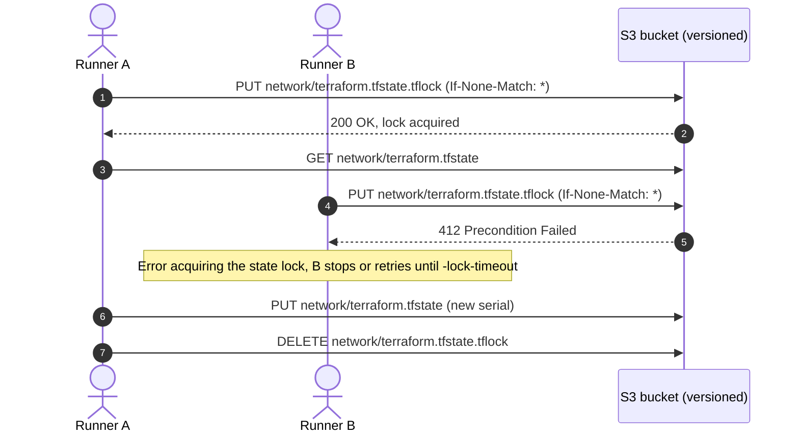

The bucket has to exist before any stack can use it. Create it once with a small bootstrap configuration that keeps its own state locally (or migrates into the bucket afterwards):

```hcl
# bootstrap/main.tf
terraform {
  required_version = ">= 1.10.0"

  required_providers {
    aws = {
      source  = "hashicorp/aws"
      version = "~> 6.0"
    }
  }
}

provider "aws" {
  region = "eu-west-1"
}

data "aws_caller_identity" "current" {}

resource "aws_kms_key" "tfstate" {
  description             = "Encrypts Terraform state"
  deletion_window_in_days = 30
  enable_key_rotation     = true
}

resource "aws_kms_alias" "tfstate" {
  name          = "alias/tfstate"
  target_key_id = aws_kms_key.tfstate.key_id
}

resource "aws_s3_bucket" "tfstate" {
  bucket = "acme-tfstate-${data.aws_caller_identity.current.account_id}"

  lifecycle {
    prevent_destroy = true
  }
}

resource "aws_s3_bucket_versioning" "tfstate" {
  bucket = aws_s3_bucket.tfstate.id
  versioning_configuration {
    status = "Enabled"
  }
}

resource "aws_s3_bucket_server_side_encryption_configuration" "tfstate" {
  bucket = aws_s3_bucket.tfstate.id
  rule {
    apply_server_side_encryption_by_default {
      sse_algorithm     = "aws:kms"
      kms_master_key_id = aws_kms_key.tfstate.arn
    }
    bucket_key_enabled = true
  }
}

resource "aws_s3_bucket_public_access_block" "tfstate" {
  bucket                  = aws_s3_bucket.tfstate.id
  block_public_acls       = true
  block_public_policy     = true
  ignore_public_acls      = true
  restrict_public_buckets = true
}

# Old state versions are your undo button; expire them eventually.
resource "aws_s3_bucket_lifecycle_configuration" "tfstate" {
  bucket = aws_s3_bucket.tfstate.id
  rule {
    id     = "expire-old-state-versions"
    status = "Enabled"
    filter {}
    noncurrent_version_expiration {
      noncurrent_days = 90
    }
  }
}
```

Each stack then points at the bucket:

```hcl
terraform {
  backend "s3" {
    bucket       = "acme-tfstate-123456789012"
    key          = "prod/network/terraform.tfstate"
    region       = "eu-west-1"
    encrypt      = true
    kms_key_id   = "alias/tfstate"
    use_lockfile = true
  }
}
```

| Argument | Operational practice |
| :--- | :--- |
| `bucket` | Versioning on, public access blocked, `prevent_destroy` on the bucket resource |
| `key` | One key per stack and environment, e.g. `prod/network/terraform.tfstate`; never share a key between stacks |
| `encrypt = true` | Server-side encryption of the state object |
| `kms_key_id` | Customer-managed key, so reading state also needs `kms:Decrypt` and is auditable in CloudTrail |
| `use_lockfile = true` | Lock object next to the state; the runner's role needs `s3:PutObject` and `s3:DeleteObject` on `*.tflock` |
| `assume_role { role_arn = ... }` | Access state with a dedicated role instead of the runner's default credentials |

Minimal IAM for a pipeline role, expressed in HCL so it lives next to the bucket:

```hcl
data "aws_iam_policy_document" "tfstate_access" {
  statement {
    actions   = ["s3:ListBucket"]
    resources = [aws_s3_bucket.tfstate.arn]
  }

  statement {
    actions   = ["s3:GetObject", "s3:PutObject"]
    resources = ["${aws_s3_bucket.tfstate.arn}/prod/*"]
  }

  statement {
    actions   = ["s3:DeleteObject"]
    resources = ["${aws_s3_bucket.tfstate.arn}/prod/*.tflock"]
  }

  statement {
    actions   = ["kms:Decrypt", "kms:Encrypt", "kms:GenerateDataKey"]
    resources = [aws_kms_key.tfstate.arn]
  }
}
```

### 3.4 State Locking and Concurrency

Every command that can write state takes the lock first: `plan` (by default), `apply`, `destroy`, `import`, `state mv` and friends. A second run that cannot get the lock fails with the holder's details:

```text
Error: Error acquiring the state lock

Error message: operation error S3: PutObject, https response error StatusCode: 412, ...
Lock Info:
  ID:        6b0f6f1a-3c1e-2d7b-91f4-5f0e4d1a2b3c
  Path:      acme-tfstate-123456789012/prod/network/terraform.tfstate
  Operation: OperationTypeApply
  Who:       runner@ci-7f9c
  Version:   1.12.2
  Created:   2026-10-20 09:14:03 UTC
```

| Command / flag | Use |
| --- | --- |
| `-lock-timeout=5m` | Wait up to 5 minutes for the lock instead of failing at once. Good default in CI |
| `terraform force-unlock LOCK_ID` | Remove a lock left behind by a crashed run. **Only after confirming the holder is dead** |
| `-lock=false` | Skip locking. Never use it on shared state |
| CI `concurrency` groups | Serialise pipelines per stack before they even reach the backend |

Locking prevents two writers at the same moment. It does not stop a stale plan: if Runner A plans, Runner B applies, and then Runner A applies its saved plan, Terraform rejects it with `Saved plan is stale` because the state serial moved. Both protections are needed.

### 3.5 State Commands: list, show, mv, rm, pull and push

These commands read or change state without touching real infrastructure (except where noted). All of them take the lock and write a new serial, and the S3 backend keeps the previous version.

```bash
# Inspect
terraform state list                                   # every address in state
terraform state list 'module.network.aws_subnet.this'  # filter by prefix
terraform state show 'aws_subnet.this["public-eu-west-1a"]'
terraform show -json | jq '.values.root_module.resources[].address'

# Rename or move (prefer moved blocks, see 3.6)
terraform state mv aws_instance.old_name aws_instance.new_name
terraform state mv aws_security_group.web module.network.aws_security_group.web

# Stop managing an object without deleting it (prefer removed blocks)
terraform state rm aws_s3_bucket.legacy_logs

# Back up and restore
terraform state pull > backup-$(date +%Y%m%d%H%M).tfstate
terraform state push backup-202610200914.tfstate      # refuses older serial or other lineage unless -force

# Replace the provider address after a provider moved namespaces
terraform state replace-provider registry.terraform.io/-/aws registry.terraform.io/hashicorp/aws
```

| Command | Changes real infrastructure? | Reviewed in a plan? | Preferred alternative |
| --- | --- | --- | --- |
| `state list` / `state show` | No | n/a | none needed |
| `state mv` | No | No | `moved` block |
| `state rm` | No (object is orphaned) | No | `removed` block with `destroy = false` |
| `state push` | No | No | Restore an S3 object version, then `init` |
| `import` (CLI) | No | No | `import` block |
| `apply -replace=ADDR` | Yes (recreates) | Yes | none: this is the reviewed form |

Quote addresses that contain brackets or quotes; shells otherwise mangle `["public-eu-west-1a"]`. On PowerShell, escape inner double quotes or use single quotes around the whole address.

### 3.6 Refactoring Without Downtime: `moved` and `removed` Blocks

Renaming a resource block, converting `count` to `for_each`, or moving resources into a module all change addresses. Without help, Terraform sees "old address gone, new address appeared" and plans a destroy plus a create. A `moved` block (1.1+) records the rename in code, so the plan shows a move instead, every environment gets it on its next apply, and reviewers see it.

```hcl
# Rename
moved {
  from = aws_instance.web
  to   = aws_instance.frontend
}

# count -> for_each: map each old index to its new key
moved {
  from = aws_subnet.public[0]
  to   = aws_subnet.this["public-eu-west-1a"]
}

moved {
  from = aws_subnet.public[1]
  to   = aws_subnet.this["public-eu-west-1b"]
}

# Root resource moved into a child module
moved {
  from = aws_vpc.main
  to   = module.network.aws_vpc.this
}
```

The plan then reads:

```text
  # aws_instance.web has moved to aws_instance.frontend
    resource "aws_instance" "frontend" {
        id = "i-0abc1234def567890"
        # (31 unchanged attributes hidden)
    }

Plan: 0 to add, 0 to change, 0 to destroy.
```

A `removed` block (1.7+) is the reviewed form of `state rm`: the object leaves state, and you choose whether it is destroyed.

```hcl
removed {
  from = aws_s3_bucket.legacy_logs

  lifecycle {
    destroy = false # keep the bucket, just stop managing it
  }
}
```

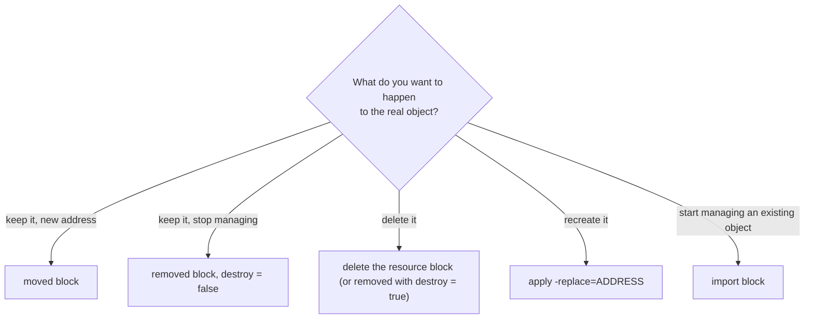

Keep `moved` blocks in the code for at least one release cycle of every consumer. In shared modules they often stay for good, because you never know which caller is still on the old address. Remove them only when every state that used the old address has been applied.

### 3.7 Importing Existing Infrastructure

Import tells Terraform "this existing object is the one this block describes". Since 1.5 it is a block in the configuration, so it goes through plan and review like any other change. The old `terraform import ADDRESS ID` command still exists but changes state immediately and requires you to write the matching block first.

```hcl
import {
  to = aws_security_group.database
  id = "sg-0123456789abcdef0"
}
```

Terraform can write the resource block for you:

```bash
terraform plan -generate-config-out=generated.tf
```

| Step | Action | Command / code |
| :--- | :--- | :--- |
| 1 | Declare the import target | `import { to = aws_vpc.main  id = "vpc-0a1b2c3d" }` |
| 2 | Generate config | `terraform plan -generate-config-out=generated.tf` |
| 3 | Clean up the generated code | Replace literal IDs with references, delete computed or default-valued arguments, move it into the right file |
| 4 | Plan again | The goal is `1 to import, 0 to add, 0 to change, 0 to destroy` |
| 5 | Apply | `terraform apply`; the import blocks can then be deleted (or kept as documentation) |

`import` blocks support `for_each` (1.7+), which is how you adopt many similar objects at once:

```hcl
locals {
  legacy_buckets = {
    logs    = "acme-legacy-logs"
    backups = "acme-legacy-backups"
  }
}

import {
  for_each = local.legacy_buckets
  to       = aws_s3_bucket.legacy[each.key]
  id       = each.value
}

resource "aws_s3_bucket" "legacy" {
  for_each = local.legacy_buckets
  bucket   = each.value
}
```

From 1.12, providers that publish **resource identity** also accept an `identity` object instead of a provider-specific `id` string, for example the account, region and name for an AWS resource. Check the provider's documentation for each resource type; the `id` form keeps working.

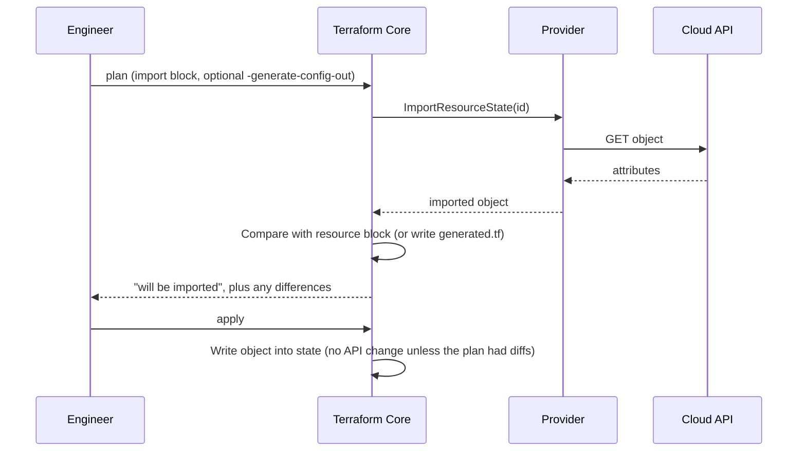

Generated code is a starting point, not a result. It hard-codes every value the API returned, including defaults and IDs of related objects; leave those in and the module becomes impossible to reuse.

### 3.8 Drift Detection and Remediation

**Drift** is any difference between state and reality caused outside Terraform: a console edit during an incident, an autoscaler, another tool. Every normal `plan` refreshes state first, so drift shows up as a proposed change back to the configured value. A **refresh-only** plan shows the drift itself and lets you accept it into state without changing anything:

```bash
terraform plan -refresh-only           # what changed outside Terraform?
terraform apply -refresh-only          # accept those values into state (asks first)
terraform plan -refresh=false          # skip refresh: faster, but blind to drift
```

```text
Note: Objects have changed outside of Terraform

  # aws_security_group.web has changed
  ~ resource "aws_security_group" "web" {
      ~ ingress = [
          + {
              + cidr_blocks = ["203.0.113.0/24"]
              + from_port   = 22
              ...
```

Three ways to resolve it:

| Strategy | When | How |
| --- | --- | --- |
| **Revert** | The change was unauthorised or temporary | `terraform apply`: configuration wins |
| **Adopt** | The change was right | Edit the configuration to match, then `plan` shows no changes |
| **Ignore** | Another system owns the attribute | `lifecycle { ignore_changes = [desired_capacity] }` |

```mermaid
flowchart TD
    CRON["Scheduled CI job (nightly)"] --> PLAN["terraform plan -detailed-exitcode -lock=false"]
    PLAN -->|"exit 0"| OK["No drift"]
    PLAN -->|"exit 2"| DRIFT["Drift or pending change"]
    PLAN -->|"exit 1"| ERR["Broken stack: page the owner"]
    DRIFT --> TICKET["Open issue with the plan output"]
    TICKET --> DECIDE{"Revert, adopt or ignore?"}
```

A drift job is a plain scheduled pipeline. Read-only credentials are enough, and `-lock=false` keeps the job from blocking real applies (it never writes state):

```bash
#!/usr/bin/env bash
set -uo pipefail
terraform init -input=false -lockfile=readonly
terraform plan -input=false -lock=false -detailed-exitcode -no-color > drift.txt
status=$?
case "$status" in
  0) echo "no drift" ;;
  2) echo "drift detected"; cat drift.txt; exit 2 ;;
  *) echo "plan failed"; cat drift.txt; exit 1 ;;
esac
```

### 3.9 Protecting State: Encryption, Access and Secrets

State holds every attribute of every resource: database endpoints, IAM policies, and any secret that passed through a resource argument, `sensitive` or not. Reading state is equivalent to reading those secrets.

| Layer | Control |
| --- | --- |
| Storage | Encrypt at rest with a customer-managed KMS key; versioning for recovery |
| Access | Separate roles for plan (read) and apply (read/write); humans read prod state only by exception |
| Audit | CloudTrail data events (or the cloud equivalent) on the state bucket and KMS key |
| Content | Keep secrets out of state with ephemeral resources and write-only attributes |
| Blast radius | One state per stack and environment, so one leaked file exposes one stack |

Since 1.10, **ephemeral** resources produce values that are never written to state or plan files. Since 1.11, providers can mark arguments as **write-only** (`*_wo`): Terraform sends the value to the provider and forgets it. Together they let a secret flow from a vault into a resource without being persisted:

```hcl
ephemeral "aws_secretsmanager_secret_version" "db" {
  secret_id = "prod/orders/db-master"
}

resource "aws_db_instance" "orders" {
  identifier          = "orders-prod"
  engine              = "postgres"
  instance_class      = "db.r7g.large"
  allocated_storage   = 100
  username            = "orders_admin"
  password_wo         = jsondecode(ephemeral.aws_secretsmanager_secret_version.db.secret_string).password
  password_wo_version = 3 # bump to push a rotated password
}
```

| Approach | Value in state? | Value in plan file? | Drift detection on the value |
| --- | --- | --- | --- |
| Plain argument from a `data` source | Yes, twice | Yes | Yes |
| `sensitive = true` variable | Yes (redacted only in output) | Yes | Yes |
| Ephemeral resource + normal argument | Yes, in the managed resource | Yes | Yes |
| Ephemeral resource + write-only argument | No | No | No: use the `_version` argument to trigger updates |
| Let the service generate it (`manage_master_user_password = true` on RDS) | No | No | Managed by the service |

When the service can own the secret, as RDS can with Secrets Manager integration, that is the simplest and safest option of all.

### 3.10 Pitfalls

| Pitfall | Symptom | Fix |
| --- | --- | --- |
| Renaming a resource block without a `moved` block | Plan shows `1 to add, 1 to destroy` for an object you only renamed | Add a `moved` block; the plan becomes a move |
| Two stacks share one state key | Each apply wants to destroy the other stack's resources | One unique `key` per stack and environment |
| Lock left by a killed CI job | `Error acquiring the state lock` with an old `Created` time | Confirm the job is dead, then `terraform force-unlock LOCK_ID` |
| `force-unlock` while a run is alive | Two writers, lost resources, serial conflicts | Check the CI system first; prefer `-lock-timeout` |
| Variables in a backend block | `Error: Variables not allowed` | Partial configuration with `-backend-config` files |
| Changing the backend block and running `plan` | `Error: Backend initialization required, please run "terraform init"` | `terraform init -migrate-state` (copy state) or `-reconfigure` (start fresh) |
| Generated import code committed as is | Hard-coded IDs, endless diffs on default-valued arguments | Clean up to references and remove computed attributes before apply |
| `state rm` instead of `removed` | Other environments still manage the object; nobody reviewed it | Use a `removed` block so the change is in code |
| Secret passed through a normal argument | Password visible in `terraform state pull` output | Ephemeral resource plus write-only argument, or a service-managed secret |
| Unversioned state bucket | A bad apply or `state push -force` cannot be undone | Enable versioning before the first stack uses the bucket |
| Drift job takes the lock | Real applies wait or fail during the nightly scan | Run drift plans with `-lock=false` and read-only credentials |

### 3.11 Best Practices

- **Use a remote backend with locking for anything shared**: local state on a laptop is a single point of failure.
- **Enable versioning and a customer-managed key on the state bucket**: versions are your undo, the key makes access auditable.
- **One state per stack and environment**: small states plan faster and limit what one mistake can touch.
- **Refactor with `moved`, `removed` and `import` blocks rather than `state` commands**: blocks are reviewed, repeatable and apply to every environment.
- **Back up with `state pull` before any manual state surgery**: it takes a second and turns a disaster into a rollback.
- **Use `-lock-timeout` and CI concurrency groups**: queued runs beat failed runs.
- **Run a scheduled `plan -detailed-exitcode` for drift**: drift found nightly is cheaper than drift found during an incident.
- **Keep secrets out of state with ephemeral values, write-only attributes or service-managed secrets**: encryption reduces exposure, absence removes it.

### 3.12 Hands-on Exercise

Practise a zero-change refactor on the starter.

1. Run `terraform apply -var-file=env/dev.tfvars` and note the pet name in `out/acme-dev-network.json`.
2. In [`main.tf`](main.tf), rename `resource "random_pet" "suffix"` to `resource "random_pet" "name_suffix"` and update the two references (in `local_file.network_plan` and in [`outputs.tf`](outputs.tf)).
3. Run `terraform plan -var-file=env/dev.tfvars`. You should see `random_pet.name_suffix` to add and `random_pet.suffix` to destroy, and the file replaced with a new name.
4. Add a `moved { from = random_pet.suffix  to = random_pet.name_suffix }` block and plan again.
5. Apply, check that the pet name in the JSON file did not change, then run `terraform state list` and `terraform destroy`.

Expected output after step 4: `random_pet.suffix has moved to random_pet.name_suffix` and `Plan: 0 to add, 0 to change, 0 to destroy.` The starter's [`tests/apply.tftest.hcl`](tests/apply.tftest.hcl) run `suffix_is_stable_across_applies` shows how to assert that a value stays stable between applies; adapt it to prove your refactor.

[Back to top ⤴️](#-table-of-contents)

---

## 4. Stage 4: Modules & Reusable Architecture

Modules package a set of resources behind a typed interface of variables and outputs. This stage covers how to cut a system into modules, how to version and distribute them, and how Terragrunt removes repeated backend configuration.

### 4.1 Module Decomposition Principles

Every Terraform directory is a module; the one you run commands in is the **root module**, and anything it calls with a `module` block is a **child module**. A well-designed child module does one job and exposes a small interface.

```mermaid
flowchart TD
    Root["Root module (environments/prod)"] --> VPCMod["module.vpc (v3.2.0)"]
    Root --> DBMod["module.aurora_postgres (v2.1.0)"]
    Root --> EKSMod["module.eks_cluster (v5.0.1)"]
    VPCMod --> AWSVPC["VPC, subnets, gateways"]
    DBMod --> AWSRDS["RDS cluster, parameter groups"]
    EKSMod --> AWSEKS["EKS control plane, node groups"]
```

#### Rules for module design

1. **No `provider` blocks inside reusable child modules.** The root module configures providers and passes aliases in with the `providers` argument. A module with its own provider block cannot be used with `count` or `for_each` and cannot be removed cleanly.
2. **No `backend` blocks inside child modules.** Backends belong only in root modules; Terraform ignores them elsewhere.
3. **Output the IDs and ARNs callers need.** Composition works only if downstream modules can reference what upstream modules created.
4. **Declare minimum versions, not exact ones.** `required_providers` in a child module should use `>=` so it composes with other modules.

### 4.2 Module Contracts: Inputs, Outputs and Semantic Versioning

Standard module layout (the starter's [`modules/subnet-plan`](modules/subnet-plan) follows it):

```text
modules/aws-vpc/
├── README.md           # generated by terraform-docs
├── main.tf             # resources
├── variables.tf        # typed, documented, validated inputs
├── outputs.tf          # documented outputs
├── versions.tf         # required_version and minimum provider versions
└── tests/              # *.tftest.hcl, run with terraform test
```

#### Module output example (`outputs.tf`)

```hcl
output "vpc_id" {
  description = "The ID of the VPC"
  value       = aws_vpc.this.id
}

output "private_subnet_ids" {
  description = "IDs of the private subnets, keyed by zone"
  value       = { for zone, s in aws_subnet.private : zone => s.id }
}

output "database_subnet_group_name" {
  description = "Name of the DB subnet group for RDS"
  value       = aws_db_subnet_group.this.name
}
```

Version modules with semantic versioning: removing or renaming a variable or output, or changing an address without a `moved` block, is a major version.

### 4.3 Terragrunt and DRY Configuration Patterns

With dozens of accounts and environments, plain Terraform repeats the same backend and provider blocks in every root module. **Terragrunt** is a thin wrapper that generates those blocks from one parent file.

```mermaid
flowchart TD
    RootTG["root.hcl: remote state and provider generation"] --> DevEnv["dev/vpc/terragrunt.hcl"]
    RootTG --> StageEnv["stage/vpc/terragrunt.hcl"]
    RootTG --> ProdEnv["prod/vpc/terragrunt.hcl"]
    ProdEnv --> RemoteModule["Git: terraform-aws-modules/vpc.git?ref=v5.0.0"]
```

#### Root `root.hcl`

```hcl
remote_state {
  backend = "s3"
  generate = {
    path      = "backend.tf"
    if_exists = "overwrite_terragrunt"
  }
  config = {
    bucket       = "acme-terragrunt-state-${get_aws_account_id()}"
    key          = "${path_relative_to_include()}/terraform.tfstate"
    region       = "eu-west-1"
    encrypt      = true
    use_lockfile = true
  }
}
```

Each environment's `terragrunt.hcl` includes it with `include "root" { path = find_in_parent_folders("root.hcl") }`. Recent Terragrunt releases recommend naming the parent file `root.hcl` rather than a second `terragrunt.hcl`.

### 4.4 Local and Remote Module Sources

```hcl
# Local directory: no version, always the code next to it
module "networking" {
  source = "../../modules/networking"
}

# Public registry with a version constraint
module "security_group" {
  source  = "terraform-aws-modules/security-group/aws"
  version = "~> 5.1"
}

# Private Git repository over SSH, pinned to a tag
module "billing_engine" {
  source = "git::ssh://git@github.com/acme-corp/infra-modules.git//payment-pipeline?ref=v2.4.1"
}
```

`version` works only with registry sources. Git sources are pinned with `?ref=`; a tag or commit SHA is reproducible, a branch name is not.

[Back to top ⤴️](#-table-of-contents)

---

## 5. Stage 5: Environments, Testing & CI/CD

This stage covers running the same code across environments, accounts and regions, testing modules with `terraform test`, and running Terraform from pull requests.

### 5.1 CLI Workspaces vs Directory-Isolated Stacks

There are two common ways to manage several environments:

```mermaid
flowchart TD
    subgraph Workspaces["CLI workspaces (one directory)"]
        W1["workspace: default"] --> S1["state: terraform.tfstate"]
        W2["workspace: dev"] --> S2["state: env:/dev/..."]
        W3["workspace: prod"] --> S3["state: env:/prod/..."]
    end
    subgraph DirectoryIsolation["Directory isolation (recommended for long-lived envs)"]
        D1["environments/dev/*.tf"] --> St1["dev state, account A"]
        D2["environments/stage/*.tf"] --> St2["stage state, account B"]
        D3["environments/prod/*.tf"] --> St3["prod state, account C"]
    end
```

| Dimension | CLI workspaces (`terraform workspace`) | Directory-isolated stacks |
| :--- | :--- | :--- |
| **State storage** | Same backend, prefixed `env:/<workspace>/` | Separate keys, buckets or accounts |
| **Blast radius** | One code change applies to every workspace | Each environment is changed and promoted on its own |
| **Access control** | Hard to give per-environment IAM | Natural: one role per environment |
| **Best use** | Short-lived copies such as feature branches | Long-lived dev, staging, prod |

### 5.2 Multi-Account and Multi-Region Architectures

Production systems spread workloads over several accounts and regions. Each region or account is a separate provider configuration, selected with `alias` and the `provider` meta-argument.

```hcl
provider "aws" {
  region = "us-east-1"
}

provider "aws" {
  alias  = "us_west_2"
  region = "us-west-2"
}

resource "aws_s3_bucket" "primary" {
  bucket = "acme-media-primary"
}

resource "aws_s3_bucket" "replica" {
  provider = aws.us_west_2
  bucket   = "acme-media-replica"
}
```

With AWS provider 6.0 and later, many resources also accept a `region` argument directly, so one provider configuration can manage several regions in the same account.

### 5.3 Cross-Stack Data Sharing via `terraform_remote_state` and SSM

Small stacks limit blast radius, but they need to share values:

1. Network stack (VPC, subnets, NAT gateways)
2. Data stack (RDS, ElastiCache, DynamoDB)
3. Compute stack (EKS, ECS, Lambda)

```mermaid
flowchart LR
    Net["Network stack"] -->|"writes SSM parameter /network/vpc_id"| SSM["SSM Parameter Store"]
    SSM -->|"data aws_ssm_parameter"| Compute["Compute stack"]
    Net -.->|"alternative: terraform_remote_state"| Compute
```

```hcl
data "terraform_remote_state" "network" {
  backend = "s3"
  config = {
    bucket = "acme-tfstate-prod"
    key    = "prod/network/terraform.tfstate"
    region = "eu-west-1"
  }
}

resource "aws_security_group" "app" {
  name   = "app-server"
  vpc_id = data.terraform_remote_state.network.outputs.vpc_id
}
```

`terraform_remote_state` needs read access to the whole upstream state, secrets included. Publishing the few values consumers need to SSM Parameter Store (or another key-value store) keeps the coupling and the permissions narrow.

### 5.4 Native Testing with `terraform test`

`terraform test` (1.6+) runs `*.tftest.hcl` files from the `tests/` directory. Each file has `run` blocks that plan or apply the configuration and check `assert` conditions; resources created by apply-mode runs are destroyed when the file finishes. The starter's suites in [`tests/`](tests) cover plan-only assertions, expected validation failures, mocked applies and a real apply.

```hcl
# tests/plan.tftest.hcl (excerpt)
variables {
  project     = "acme"
  environment = "dev"
  owner       = "platform-team"
}

run "subnets_are_carved_in_tier_then_zone_order" {
  command = plan

  assert {
    condition     = output.subnet_cidrs["private-eu-west-1a"] == "10.20.3.0/24"
    error_message = "The private tier must start after the three public blocks."
  }
}
```

| Test attribute | Purpose |
| :--- | :--- |
| `run "name"` | One test step; runs in file order and shares state with earlier runs in the same file |
| `command = plan` | Plan only; nothing is created |
| `command = apply` (default) | Creates real (or mocked) resources; torn down after the file |
| `variables { ... }` | Inputs, at file level or per run |
| `assert { condition, error_message }` | Must be true for the run to pass |
| `expect_failures = [var.x]` | The run passes only if exactly these checkable objects fail |
| `mock_provider "name" { ... }` | Replace a provider with generated fake responses (1.7+) |

### 5.5 GitOps Pipelines with Atlantis and GitHub Actions

Infrastructure changes should go through pull requests: the plan is posted for review, and apply happens only after approval.

```mermaid
sequenceDiagram
    autonumber
    actor Dev as Engineer
    participant PR as GitHub pull request
    participant Atl as Atlantis
    participant AWS as AWS

    Dev->>PR: Open PR with HCL changes
    PR->>Atl: Webhook
    Atl->>AWS: terraform plan
    Atl->>PR: Comment with the plan
    Dev->>PR: Comment "atlantis apply" after approval
    PR->>Atl: Webhook
    Atl->>AWS: terraform apply (saved plan)
    Atl->>PR: Comment with apply output, optional automerge
```

[Back to top ⤴️](#-table-of-contents)

---

## 6. Stage 6: Security, Governance & Policy as Code

This stage covers guardrails that run before anything is applied: policy checks on plan JSON, static scanners, and keeping secrets out of code.

### 6.1 Policy as Code: Open Policy Agent (Rego) and Sentinel

Policy engines read the machine-readable plan and block a merge when a rule is broken.

```mermaid
flowchart LR
    Plan["terraform plan -out=tfplan"] --> Show["terraform show -json tfplan > plan.json"]
    Show --> OPA["conftest / OPA with policy/*.rego"]
    OPA -->|"pass"| Apply["terraform apply tfplan"]
    OPA -->|"violations"| Block["Pipeline fails, merge blocked"]
```

#### Example Rego rule (OPA 1.0 syntax)

```rego
package terraform.security

import rego.v1

# Every new or updated S3 bucket must have a matching encryption configuration resource.
deny contains msg if {
    bucket := input.resource_changes[_]
    bucket.type == "aws_s3_bucket"
    bucket.change.actions[_] in {"create", "update"}
    not has_encryption(bucket.change.after.bucket)
    msg := sprintf("S3 bucket %v needs aws_s3_bucket_server_side_encryption_configuration", [bucket.address])
}

has_encryption(name) if {
    enc := input.resource_changes[_]
    enc.type == "aws_s3_bucket_server_side_encryption_configuration"
    enc.change.after.bucket == name
}
```

```bash
terraform show -json tfplan > plan.json
conftest test plan.json --policy policy/
```

Sentinel is HashiCorp's policy language for HCP Terraform and Terraform Enterprise; HCP Terraform also runs OPA policies natively.

### 6.2 Static Security Scanning: Checkov, Trivy and TFLint

```bash
# Compliance checks (CIS, PCI-DSS, HIPAA mappings)
checkov -d . --framework terraform

# Misconfiguration scanning; tfsec's checks now live in Trivy
trivy config .

# Provider-aware linting: invalid instance types, deprecated syntax, unused declarations
tflint --init && tflint --recursive
```

| Tool | Specialisation | Where it runs |
| :--- | :--- | :--- |
| **Checkov** | Broad policy library across AWS, Azure, GCP and Kubernetes | Pull request checks |
| **TFLint** | Provider-specific errors and Terraform style rules (this repo's CI uses its `recommended` preset) | Pre-commit and CI |
| **Trivy** | One scanner for IaC, container images and SBOMs; absorbed tfsec | CI |

### 6.3 Secret Injection with Vault and KMS

Never put secrets in `.tf` files or committed variable files.

```mermaid
sequenceDiagram
    autonumber
    participant TF as Terraform runner
    participant Vault as HashiCorp Vault
    participant DB as AWS RDS

    TF->>Vault: Authenticate (AWS IAM or JWT/OIDC auth method)
    Vault-->>TF: Short-lived token
    TF->>Vault: Read database credentials
    TF->>DB: Configure the database
    Note over TF,DB: No secret in version control
```

```hcl
data "vault_kv_secret_v2" "db" {
  mount = "secret"
  name  = "production/database"
}

resource "aws_db_instance" "prod" {
  identifier          = "production-postgres"
  engine              = "postgres"
  instance_class      = "db.r7g.xlarge"
  allocated_storage   = 100
  username            = "dbadmin"
  password            = data.vault_kv_secret_v2.db.data["password"]
  skip_final_snapshot = false
}
```

A data source keeps the secret out of Git but still writes it to state. Where the provider offers an ephemeral resource and the target resource a write-only argument, use those instead ([3.9](#39-protecting-state-encryption-access-and-secrets)).

[Back to top ⤴️](#-table-of-contents)

---

## 7. Stage 7: Staff Terraform Platform Engineer Interview Handbook & Cheatsheet

### 7.1 Core Concepts (Q1-Q10)

#### Q1. What is the difference between `terraform plan` and `terraform apply -refresh-only`?

`terraform plan` refreshes state against the real infrastructure, evaluates the configuration, and proposes the creates, updates and deletes needed to make reality match the configuration. `terraform apply -refresh-only` only reads the real infrastructure and proposes updating the **state** to match it; it never changes a real object. Use the first to change infrastructure and the second to accept drift into state after deciding it is correct.

#### Q2. How does Terraform build its dependency graph and decide execution order?

Terraform parses every block and turns each resource, data source, local, output, module call and provider configuration into a graph node. Each reference creates an edge: `vpc_id = aws_vpc.main.id` makes the subnet depend on the VPC. `depends_on` adds edges where no reference exists. Terraform then checks the graph for cycles and walks it, starting every node whose dependencies are complete, up to the `-parallelism` limit (10 by default). Destroys walk the same graph in reverse, using the dependencies recorded in state for objects whose blocks are gone.

#### Q3. Why does `count` cause unexpected replacements when you remove a middle element, and how does `for_each` fix it?

`count` addresses instances by position: `aws_subnet.public[0]`, `[1]`, `[2]`. Remove the element at index 1 and the element that was at index 2 is now at index 1, so Terraform plans to change `[1]` into what `[2]` was (often a forced replacement) and destroy `[2]`. `for_each` addresses instances by key (`aws_subnet.this["eu-west-1b"]`), so removing one key affects only that instance. Existing `count` resources can be converted without downtime by adding `moved` blocks from each index to its new key.

#### Q4. How do you resolve a dependency cycle?

A cycle means object A references B and B references A, for example two security groups whose inline rules allow each other. Terraform cannot order them and fails with `Error: Cycle: ...`. Break the cycle by moving the mutual part into separate resources: create both groups without inline rules, then add `aws_vpc_security_group_ingress_rule` resources that reference both group IDs. The groups no longer depend on each other; the rules depend on both.

#### Q5. What happens during `terraform init`?

1. Terraform reads the `backend` (or `cloud`) block, configures access to state and, if the backend changed, asks to migrate or reconfigure.
2. It downloads module sources (registry, Git, local paths are linked) into `.terraform/modules`.
3. It resolves each `required_providers` entry against the lock file and the registry, downloads the provider packages, verifies the registry signature and the checksums in `.terraform.lock.hcl`, and unpacks them into `.terraform/providers` (or links them from `TF_PLUGIN_CACHE_DIR`).
4. It records any newly selected versions and hashes in the lock file, unless `-lockfile=readonly` is set.

#### Q6. What is `.terraform.lock.hcl` and why must it be committed?

Introduced in 0.14, the dependency lock file records the exact version of each provider and the checksums of its packages. With it committed, every laptop and CI runner installs the same provider builds, and a package whose checksum does not match is rejected, which protects against tampered mirrors. Upgrades become explicit (`terraform init -upgrade`) and show up as a reviewable diff. It does not lock module versions; pin those in the `module` block.

#### Q7. How does Terraform handle sensitive values, and what is the main limitation?

`sensitive = true` on a variable or output, and provider schemas that mark attributes sensitive, make Terraform redact those values in plan and apply output. The values are still stored in plain text in state and in saved plan files. Protect them with backend encryption and tight access, and keep secrets out of state entirely with ephemeral resources and write-only arguments (1.10 and 1.11), or let the service manage the secret.

#### Q8. What is drift, and what are the ways to deal with it?

Drift is a difference between state and reality caused outside Terraform: a console change, another tool, an autoscaler. A normal `plan` detects it and proposes reverting. The options are: **revert** by applying the configuration; **adopt** by changing the configuration to match reality; **accept into state** with `apply -refresh-only` when the configuration already allows the new value; or **ignore** an attribute owned by another system with `lifecycle { ignore_changes = [...] }`. A scheduled `plan -detailed-exitcode` job finds drift before it surprises someone.

#### Q9. What replaced `terraform taint`?

`terraform taint` (deprecated since 0.15.2) marked an object in state for replacement immediately, outside any plan, so the change was invisible to reviewers. `terraform apply -replace="aws_instance.web"` (also accepted by `plan`) puts the replacement into the plan instead, where it can be reviewed and saved like any other change.

#### Q10. How do you import a large estate of existing resources?

1. Inventory what exists and decide the target structure first (stacks, modules, keys), so imported resources land at their final addresses.
2. Write `import` blocks (1.5+), using `for_each` (1.7+) for similar objects:

    ```hcl
    import {
      for_each = toset(["bucket-a", "bucket-b"])
      to       = aws_s3_bucket.legacy[each.key]
      id       = each.key
    }
    ```

3. Run `terraform plan -generate-config-out=generated.tf` to draft the resource blocks, then refactor them: references instead of IDs, no computed or default-valued arguments.
4. Plan until the result is imports only, with no changes, then apply. Discovery tools such as Terraformer can help with inventory, but their output needs the same clean-up.

### 7.2 Internals & Performance (Q11-Q20)

#### Q11. What does `prevent_destroy` do and what does it not do?

`lifecycle { prevent_destroy = true }` makes Terraform reject any plan that would destroy the object, whether from deleting it, replacing it because an immutable attribute changed, or running `terraform destroy`. It does not protect against deleting the resource block itself (the setting goes with the block), against `state rm`, or against deletion outside Terraform. For real protection combine it with the provider's own deletion protection (`deletion_protection = true` on RDS) and IAM.

#### Q12. How does `create_before_destroy` work, and what can go wrong?

By default a replacement destroys the old object and then creates the new one. With `create_before_destroy = true` Terraform creates the replacement first, updates dependents to point at it, and then destroys the old object, which avoids downtime. It fails for objects with unique names (a fixed S3 bucket name or IAM role name), because the new object cannot be created while the old one holds the name; use `name_prefix` or a random suffix. The setting also propagates to the dependencies of the resource, which can surprise you.

#### Q13. How do you handle database changes safely with Terraform?

Terraform manages the database infrastructure, not the schema; use a migration tool (Flyway, Liquibase, the application's ORM) for schema changes. For infrastructure changes such as instance class or engine version, use Multi-AZ so the standby is changed first and a failover follows, set `apply_immediately = false` to defer disruptive changes to the maintenance window, keep `deletion_protection` and `prevent_destroy` on, and read the plan for `-/+` on the database before approving.

#### Q14. In what order does Terraform read variable values?

From lowest to highest precedence: the `default` in the variable block, `TF_VAR_name` environment variables, `terraform.tfvars`, `terraform.tfvars.json`, `*.auto.tfvars` and `*.auto.tfvars.json` in lexical order, then `-var` and `-var-file` options in the order they appear on the command line. A later source overrides an earlier one.

#### Q15. When should you use `terraform_remote_state` versus a parameter store for cross-stack values?

`terraform_remote_state` reads the outputs of another state directly. It is simple, but the consumer needs read access to the producer's entire state, including any secrets in it, and it couples the consumer to the producer's backend layout. Publishing selected values to SSM Parameter Store (or Consul, or a similar store) keeps the interface explicit and the permissions narrow, at the cost of one extra resource per value in the producer.

#### Q16. How do you debug a provider error or a Terraform crash?

Set `TF_LOG=DEBUG` (or `TRACE`) and `TF_LOG_PATH=terraform.log`, then rerun. `TF_LOG_CORE` and `TF_LOG_PROVIDER` set the levels separately. `TRACE` shows the gRPC calls between Core and the provider and, for most providers, the HTTP requests and responses. A crash writes `crash.log`. Scrub logs before sharing them: they contain request bodies, tokens and state values.

#### Q17. What are the risks of an unencrypted or broadly readable state bucket?

State contains a map of the estate (IDs, network ranges, IAM policies) and the values of every attribute, including passwords and keys that passed through resource arguments, whether or not they were marked sensitive. Anyone who can read the bucket can read those secrets. Use a customer-managed KMS key, block public access, grant read only to the roles that plan and apply, and turn on access logging or CloudTrail data events.

#### Q18. How do you test Terraform code?

Layer the checks from cheapest to most expensive: `terraform fmt -check` and `terraform validate`; TFLint; security scanners such as Checkov or Trivy; `terraform test` with plan-mode runs and mock providers for logic; `terraform test` apply-mode runs against a sandbox account for integration; and, for behaviour that only shows up end to end, Terratest (Go) to call the deployed system and clean up afterwards. The starter project runs the first, second and fourth layers in CI.

#### Q19. What is the difference between `merge()` and `coalesce()`?

`merge(map1, map2, ...)` combines maps (or objects) into one, with later arguments overriding earlier ones for duplicate keys. `coalesce(a, b, ...)` returns the first argument that is not null and not an empty string. Use `merge` for layering tags or settings and `coalesce` for "first value that is set" defaults; for nested or optional attributes `try()` is often clearer.

#### Q20. What is the provider plugin protocol, and what is the difference between versions 5 and 6?

Core and providers talk over a gRPC interface called the plugin protocol. Version 5 is what providers built with the older SDKv2 speak. Version 6 adds features such as nested attributes in schemas and is used by providers built with the Terraform Plugin Framework (which can also serve protocol 5). Terraform 1.x supports both, so users rarely notice the difference; it matters when you write providers or pin very old Terraform versions.

### 7.3 Architecture & Design (Q21-Q25)

#### Q21. How do you control cost before deploying?

Run Infracost (or a similar tool) in the pull request pipeline against the plan JSON. It prices the planned resources and posts the monthly cost difference on the pull request, so reviewers see the cost of a change alongside the diff. Add policy rules (OPA or Sentinel) for hard limits such as forbidden instance families, and tag every resource for cost allocation through provider `default_tags`.

#### Q22. What is the difference between `terraform state rm` and destroying a resource?

`terraform state rm` deletes the entry from state; the real object keeps running and Terraform simply stops managing it. Destroying (removing the block and applying, or `terraform destroy`) sends delete calls to the provider. The reviewed, code-based form of `state rm` is a `removed` block with `lifecycle { destroy = false }`.

#### Q23. How do you stop two pipelines from applying the same stack at once?

Use a backend with locking (S3 with `use_lockfile`, GCS, azurerm, HCP Terraform): the second run fails or waits (`-lock-timeout`) while the first holds the lock. Add CI-level serialisation, such as a GitHub Actions `concurrency` group per stack, so runs queue instead of failing. Apply saved plans, so a plan made before someone else's apply is rejected as stale instead of overwriting their change.

#### Q24. What are `moved` blocks for?

`moved` blocks (1.1+) record that an object's address changed: a rename, a move into a module, or a `count` to `for_each` conversion. During plan Terraform updates the state address instead of planning a destroy and create.

```hcl
moved {
  from = aws_instance.web
  to   = aws_instance.frontend
}
```

They replace `terraform state mv` for most refactors, because they are reviewed in code and every environment picks them up on its next apply.

#### Q25. How would you design a zero-trust pipeline for Terraform across clouds?

1. Authenticate CI to each cloud with OIDC federation, not long-lived keys, and give plan and apply jobs separate roles (read-only for plan).
2. Require pull requests, saved plans and protected environments with approvals for apply.
3. Gate merges on policy as code (OPA or Sentinel) and static scanners.
4. Store state encrypted with customer-managed keys, one state per stack, with access logged.
5. Run scheduled drift detection and alert on unexpected changes.

### 7.4 Scenario & Debugging Questions (Q26-Q27)

#### Q26. A small security group change produces a plan that wants to replace the production database. What happened and what do you do?

Stop: do not apply. The likely cause is a monolithic state in which network, data and compute live together, so an unrelated change (a provider upgrade, a changed default, a drifted parameter group) shows up in the same plan as the edit. Read the plan for the `# forces replacement` marker on the database to find the attribute responsible, and fix that attribute (or add `ignore_changes` if another system owns it) until the plan touches only the security group. Then reduce the blast radius for the future: split the state into network, data and compute stacks, moving resources with `removed` (`destroy = false`) in the old stack and `import` blocks in the new one, and add `prevent_destroy` plus provider deletion protection to the database.

#### Q27. An apply was interrupted and the state now looks wrong or the stack is locked. How do you recover?

1. Find out whether the run is really dead (CI job status, the `Who` and `Created` fields in the lock error). Only then run `terraform force-unlock LOCK_ID`.
2. Run `terraform plan`. Objects that were created but not recorded appear as creates and will fail with "already exists"; adopt them with `import` blocks.
3. If the state object itself is corrupt or was overwritten, restore the previous version from the versioned bucket, for example with `aws s3api list-object-versions --bucket acme-tfstate-123456789012 --prefix prod/network/terraform.tfstate` and then copying the chosen version back over the current key.
4. Run `terraform plan -refresh-only` to reconcile attributes, review, and `apply -refresh-only` if the result is correct.

### 7.5 Staff Cheatsheet

| Need | Terraform answer | Gotcha |
| --- | --- | --- |
| Rename a resource | `moved { from = a.old  to = a.new }` | Keep it until every state has applied it |
| Stop managing, keep object | `removed { from = a.x  lifecycle { destroy = false } }` | Needs 1.7+ |
| Adopt existing object | `import { to = a.x  id = "..." }` + `plan -generate-config-out` | Clean the generated code |
| Force recreation | `apply -replace=ADDRESS` | Not `taint` |
| Accept drift | `apply -refresh-only` | Reviews the drift, does not change infra |
| Detect changes in CI | `plan -detailed-exitcode` | Exit 2 means changes, not failure |
| Lock state on S3 | `use_lockfile = true` | DynamoDB locking is deprecated |
| Pin providers | `~> 6.0` + committed lock file with all platforms | `~> 6.0.0` blocks minors |
| Secret without state | ephemeral resource + `*_wo` argument | Bump `*_wo_version` to rotate |
| Many instances by identity | `for_each` over a map or set | Keys must be known at plan time |
| Optional single resource | `count = var.enabled ? 1 : 0` + `one(...)` | Index `[0]` fails when count is 0 |
| Input rule across variables | `validation` referencing other vars | Needs 1.9+ |
| Soft rule | `check` block | Warns, never fails |
| Unit-test a module | `terraform test` + `mock_provider` | Plan-mode values from resources are unknown |

[Back to top ⤴️](#-table-of-contents)

---

## 🧪 Example Projects

| Project | Builds on | What you practise | Stretch goal |
| --- | --- | --- | --- |
| [Starter: network planner](./main.tf) (in this repo) | [Stage 1](#18-walking-through-the-starter-project), [Stage 2](#25-expressions-conditionals-for-splat-and-dynamic-blocks), [Stage 3](#312-hands-on-exercise) | Typed and validated inputs, `cidrsubnet`, a child module, `terraform_data`, conditions, `terraform test` with mocks | Add an IPv6 plan with `cidrsubnet` on a /56 |
| Remote state bootstrap | [3.3](#33-remote-state-on-s3-with-native-locking) | S3 bucket with versioning, KMS, public access block, `use_lockfile` | Migrate the bootstrap's own state into the bucket with `init -migrate-state` |
| AWS VPC from the starter's plan | [2.7](#27-meta-arguments-count-for_each-provider-depends_on-and-lifecycle), [4.1](#41-module-decomposition-principles) | `for_each` over `module.subnets.subnets` to create real `aws_subnet` resources | Add NAT gateways per zone behind a `count` toggle |
| Import a hand-built estate | [3.7](#37-importing-existing-infrastructure) | `import` blocks with `for_each`, `-generate-config-out`, clean-up | Reach a zero-change plan with no hard-coded IDs |
| Drift detector | [3.8](#38-drift-detection-and-remediation) | Scheduled `plan -detailed-exitcode`, read-only role, issue creation | Post the drift summary to chat with a link to the job |
| Reusable module with tests | [4.2](#42-module-contracts-inputs-outputs-and-semantic-versioning), [5.4](#54-native-testing-with-terraform-test) | Module contract, semantic versioning, `terraform test` suites | Publish it to a private registry |
| Policy-gated pipeline | [6.1](#61-policy-as-code-open-policy-agent-rego-and-sentinel), [5.5](#55-gitops-pipelines-with-atlantis-and-github-actions) | Plan JSON, conftest, PR comments | Add Infracost and fail on a cost threshold |

## 📝 Cheat Sheets

### CLI / Commands

```bash
terraform version                                   # CLI and provider versions
terraform init                                      # providers, modules, backend
terraform init -upgrade                             # newest versions within constraints
terraform init -backend-config=backends/prod.s3.tfbackend
terraform init -migrate-state                       # move state to a new backend
terraform providers lock -platform=linux_amd64 -platform=darwin_arm64
terraform fmt -recursive                            # format everything
terraform fmt -check -recursive                     # CI gate
terraform validate                                  # syntax, types, references
terraform console                                   # evaluate expressions
terraform plan -var-file=env/dev.tfvars -out=tfplan
terraform plan -detailed-exitcode                   # 0 none, 1 error, 2 changes
terraform plan -refresh-only                        # show drift
terraform plan -generate-config-out=generated.tf    # with import blocks
terraform show tfplan                               # human-readable saved plan
terraform show -json tfplan > plan.json             # for policy tools
terraform apply tfplan                              # apply the reviewed plan
terraform apply -replace='aws_instance.web'         # force recreation
terraform apply -refresh-only                       # accept drift into state
terraform destroy                                   # delete everything in state
terraform output -json                              # all outputs as JSON
terraform state list
terraform state show 'aws_subnet.this["public-eu-west-1a"]'
terraform state pull > backup.tfstate
terraform force-unlock LOCK_ID
terraform graph -type=plan | dot -Tsvg > graph.svg
terraform test                                      # run tests/*.tftest.hcl
terraform test -filter=tests/plan.tftest.hcl        # one file
terraform workspace list
```

### HCL Quick Reference

| Task | Code |
| --- | --- |
| String template | `"${var.project}-${var.environment}"` |
| Conditional | `var.env == "prod" ? 3 : 1` |
| List from list | `[for z in var.zones : upper(z)]` |
| Map from list | `{ for u in var.users : u.name => u.role }` |
| Group by key | `{ for s in local.subnets : s.tier => s.cidr... }` |
| Filter | `[for u in var.users : u.name if u.active]` |
| Splat | `aws_subnet.public[*].id` |
| Flatten nested | `flatten([for t in var.tiers : [for z in var.zones : "${t}-${z}"]])` |
| Default on error | `try(var.cfg.port, 8080)` |
| Optional attribute | `optional(number, 3)` |
| Toggle a resource | `count = var.enabled ? 1 : 0` |
| Read a toggled resource | `one(aws_kms_key.this[*].arn)` |
| Many by key | `for_each = toset(var.names)` |
| Carve a subnet | `cidrsubnet("10.20.0.0/16", 8, 3)` |
| Render a template file | `templatefile("${path.module}/tpl.tftpl", { port = 80 })` |

## 📚 Resources

- [Terraform documentation](https://developer.hashicorp.com/terraform/docs)
- [Terraform language reference](https://developer.hashicorp.com/terraform/language)
- [Terraform CLI reference](https://developer.hashicorp.com/terraform/cli)
- [Terraform tests](https://developer.hashicorp.com/terraform/language/tests)
- [Terraform releases and changelog](https://github.com/hashicorp/terraform/releases)
- [Terraform source repository](https://github.com/hashicorp/terraform)
- [Terraform Registry](https://registry.terraform.io/)
- [HashiCorp blog: Terraform](https://www.hashicorp.com/blog/products/terraform)
- [OpenTofu documentation](https://opentofu.org/docs/)
- [OpenTofu source repository](https://github.com/opentofu/opentofu)

## 🤝 Contributing

Contributions are welcome. Read the [contributing guide](https://github.com/TheLearningHubOrg/.github/blob/main/CONTRIBUTING.md) and the [code of conduct](https://github.com/TheLearningHubOrg/.github/blob/main/CODE_OF_CONDUCT.md) before you open a pull request. Commit messages follow [Conventional Commits](https://www.conventionalcommits.org/), which drive the automated changelog.

Before you push, run the same checks as CI:

```bash
terraform fmt -check -recursive
terraform init -backend=false
terraform validate
terraform test
```

## 📄 License

This project is licensed under the MIT License. See the [LICENSE](LICENSE) file for details.

## 🙏 Acknowledgments

- [Terraform](https://developer.hashicorp.com/terraform) and its maintainers
- [OpenTofu](https://opentofu.org/) and the Linux Foundation community
- The [hashicorp/random](https://registry.terraform.io/providers/hashicorp/random/latest) and [hashicorp/local](https://registry.terraform.io/providers/hashicorp/local/latest) providers used by the starter
- [TFLint](https://github.com/terraform-linters/tflint), used in CI

## 🌐 Connect with me

- [Twitter](https://twitter.com/manthan_ank)
- [LinkedIn](https://www.linkedin.com/in/manthanank)
- [Facebook](https://www.facebook.com/manthanank/)
- [Instagram](https://www.instagram.com/manthan_ank/)
- [YouTube](https://www.youtube.com/@manthanank)
- [GitHub](https://github.com/manthanank)

## ☕ Support

If you like this learning repository and find it useful, consider buying me a coffee or sponsoring me through GitHub Sponsors. Your support helps me keep these guides up to date. Thank you!

[](https://www.buymeacoffee.com/manthanank)

[](https://github.com/sponsors/manthanank)

---

Show your support by 🌟 the repository.
